# DOKUMEN ARSITEKTUR TEKNIS & DESAIN SISTEM
## Proyek: ENZO Construction — Web Platform & Lead Generation Engine
### Modul Asistensi: Review ERD, Wireframe UI/UX, dan Diagram UML

> **Topik Asistensi**: Review ERD, Wireframe UI/UX, Diagram UML  
> **Status Dokumen**: Final & Terverifikasi (Sinkron 100% dengan Migrasi Basis Data & Kode Laravel)  
> **Target Pengguna**: Calon Klien B2B/B2C, Tim Estimator & Sales Engineer, Administrator Sistem  
> **Basis Teknologi**: Laravel 12/13, PHP 8.3+, MySQL / SQLite, Tailwind CSS, Alpine.js  

---

## DAFTAR ISI
0. [BAGIAN 0: MATRIKS TINDAK LANJUT EVALUASI & MASUKAN DOSEN (10 POIN REVISI)](#bagian-0-matriks-tindak-lanjut-evaluasi--masukan-dosen-10-poin-revisi)
   - 0.1 Ringkasan 10 Poin Evaluasi Dosen & Solusi Rekayasa Sistem
   - 0.2 Validasi Masalah & Riset Pasar (Developer B2B vs Konsumen B2C)
1. [BAGIAN 1: REVIEW ERD (ENTITY RELATIONSHIP DIAGRAM)](#bagian-1-review-erd-entity-relationship-diagram)
   - 1.1 Deskripsi Konseptual & Arsitektur Data
   - 1.2 Diagram ERD (Mermaid) Terkini (12 Entitas Relasional)
   - 1.3 Kamus Data Lengkap (Data Dictionary) Seluruh Entitas Baru & Modifikasi
   - 1.4 Aturan Integritas Referensial & Normalisasi Basis Data (3NF)
2. [BAGIAN 2: WIREFRAME ANTARMUKA UI/UX](#bagian-2-wireframe-antarmuka-uiux)
   - 2.1 Konsep & Prinsip Desain UI/UX (Luxury Dark Architecture, Cinzel Typography, Glassmorphism)
   - 2.2 Wireframe 1: Beranda (Landing Page)
   - 2.3 Wireframe 2: Portofolio Proyek & Fitur Before-After (Dengan Masking Privasi)
   - 2.4 Wireframe 3: Kalkulator Estimasi Biaya Bangun (RAB Interaktif)
   - 2.5 Wireframe 4: Formulir Pengajuan Penawaran Tender (RFP) Terintegrasi Layout & Skema Bayar
   - 2.6 Wireframe 5: Dashboard Admin CMS & Lead Pipeline Tracker (Dengan Banner Reminder)
   - 2.7 Wireframe 6: Katalog Referensi Desain & Pemilihan Denah Layout Siap Pakai
   - 2.8 Wireframe 7: Matriks Spesifikasi Teknis Material Komparatif Rinci
   - 2.9 Wireframe 8: Dasbor Pelacakan Progres Lapangan, Jurnal Mandor (3D vs Nyata), Komplain, & Testimoni
   - 2.10 Wireframe 9: Detail Tiket Admin: Penugasan Staf PIC, Log Negosiasi, & Publikasi Portofolio Otomatis
3. [BAGIAN 3: DIAGRAM UML (UNIFIED MODELING LANGUAGE)](#bagian-3-diagram-uml-unified-modeling-language)
   - 3.1 Use Case Diagram Komprehensif & Spesifikasi Kasus Penggunaan
   - 3.2 Activity Diagram (Alur Pengajuan Tender, Penugasan PIC, & Komplain)
   - 3.3 Sequence Diagram (Alur Pengingat Admin, Progres Lapangan, & Portofolio)
   - 3.4 Class Diagram (Arsitektur Backend Laravel MVC & Relasi Eloquent)
4. [KESIMPULAN & KESIAPAN IMPLEMENTASI](#bagian-4-kesimpulan--kesiapan-implementasi)

---

# BAGIAN 0: MATRIKS TINDAK LANJUT EVALUASI & MASUKAN DOSEN (10 POIN REVISI)

### 0.1 Ringkasan 10 Poin Evaluasi Dosen & Solusi Rekayasa Sistem

Berdasarkan hasil asistensi dan sesi evaluasi dosen penguji/pembimbing, sistem **ENZO Construction** telah disempurnakan secara menyeluruh dengan mengintegrasikan 10 pilar perbaikan sistematis berikut:

| No | Poin Masukan & Evaluasi Dosen | Akar Masalah / Latar Belakang | Solusi Implementasi Sistem ENZO Construction | Status Verifikasi Kode |
|:--:|---|---|---|:---:|
| **1** | **Validasi Masalah & Kebutuhan Pengguna (Riset Pasar)** | Dosen menanyakan apakah fitur hanya asumsi sepihak atau berdasar riset kebutuhan pengembang (*developer*) & konsumen akhir. | Penggalian riset pasar: Segmentasi persona **B2B Developer/Kontraktor** (butuh transparansi tender, kelengkapan berkas DWG/CAD, SPK cepat) vs **B2C Homeowner** (kebingungan denah, butuh komparasi material awam, dan pemantauan harian). | **Selesai (Bab 0.2)** |
| **2** | **Fitur Referensi Desain & Tata Letak (Layout)** | Konsumen awam kesulitan membuat denah mandiri; sistem butuh katalog siap pakai selain opsi upload custom. | Modul **Katalog Layout Denah** (`/layouts`) berisi denah standar 2D + render 3D (Tipe 45, Tipe 70, Tipe 120, Villa Tropis), luas bangunan/tanah, dan estimasi biaya siap pilih langsung ke form tender RFP. | **Selesai (`DesignLayout`)** |
| **3** | **Spesifikasi Material Rinci (Komparatif)** | Spesifikasi bangunan perlu komparatif agar konsumen paham perbedaan kualitas dan konsekuensi biaya. | Modul **Tabel Matriks Spesifikasi Komparatif** (`/specifications`) membandingkan Grade Standar vs Premium vs Luxury untuk: Pondasi/kolom beton bertulang, jenis lantai (keramik vs granit/marmer), rangka atap (baja ringan vs kayu kamper), genteng metal vs keramik/beton, utilitas PDAM/PLN, dan carport. | **Selesai (`SpecificationComparisonController`)** |
| **4** | **Notifikasi & Pengingat Admin (Admin Reminder)** | Mekanisme pengingat otomatis jika pesanan baru masuk agar tidak terabaikan saat admin lupa membuka web; otomatis berhenti saat admin login/buka. | Background reminder logic & banner peringatan mencolok di CMS Admin jika pesanan baru berstatus `submitted` belum dibuka > 6 jam (`admin_last_viewed_at`). Begitu admin membuka tiket detail, timestamp tercatat dan notifikasi otomatis berhenti. | **Selesai (`needsAdminAttention()`)** |
| **5** | **Manajemen Alur Pesanan & Penugasan (Task Assignment)** | Konfirmasi awal pesanan via telepon, penugasan staf PIC, dan rekam jejak tahap negosiasi hingga kesepakatan (*deal*). | Fitur **Penugasan Staf** (`assigned_to_user_id`) untuk Estimator/Project Manager, integrasi tombol WhatsApp satu-klik dengan draft pesan sopan, serta tabel **Riwayat Negosiasi** (`rfp_negotiation_logs`) mencatat proposal awal, revisi BOQ, hingga kontrak deal. | **Selesai (`RfpNegotiationLog`)** |
| **6** | **Skema & Opsi Pembayaran** | Kejelasan metode pembayaran setelah kesepakatan tercapai agar transaksi transparan. | Opsi skema pembayaran terstandarisasi: **Tunai Keras (*Cash*)**, **Tunai Bertahap (*Cash Tempo*)** berbasis 4 termin opname fisik lapangan, dan fasilitas **KPR Konstruksi Bank Rekanan** (BCA, Mandiri, BNI) tercatat di tiket tender. | **Selesai (`payment_scheme`)** |
| **7** | **Pemantauan Progres Pembangunan (Progress Tracking)** | Dasbor pemantauan berkala konsumen, laporan harian mandor (Hari ke-1, 15, 35, dst.), dan perbandingan render 3D vs fisik nyata. | Portal pelacakan publik (`/rfp/track`) dilengkapi **Jurnal Harian Mandor** (`construction_progress_logs`) dengan foto perbandingan berdampingan: Desain Render 3D yang dijanjikan vs Foto Fisik Nyata di Lapangan, persentase opname, dan catatan cuaca. | **Selesai (`ConstructionProgressLog`)** |
| **8** | **Fitur Komplain / Pengaduan Lapangan** | Wadah keluhan jika pengerjaan fisik tidak sesuai perjanjian (beda warna pintu/cat, posisi sanitasi/WC geser, retak acian). | Portal **Pengaduan Garansi Pengerjaan** (`project_complaints`) di dasbor tiket konsumen. Konsumen dapat mengunggah bukti foto & deskripsi ketidaksesuaian fisik; admin memproses status (Dilaporkan $\rightarrow$ Investigasi $\rightarrow$ Perbaikan $\rightarrow$ Tuntas). | **Selesai (`ProjectComplaint`)** |
| **9** | **Portofolio Proyek Otomatis & Testimoni** | Proyek rampung otomatis masuk etalase publik dan fitur input ulasan bintang konsumen. | Tombol 1-klik di panel admin untuk mempublikasikan tiket proyek selesai ke katalog publik (`projects`), serta form testimoni bintang (1-5) dan review kepuasan klien langsung tersimpan di sistem. | **Selesai (`publishPortfolio`)** |
| **10** | **Kebijakan Privasi Data Hunian (Data Privacy)** | Alamat lengkap dan identitas hunian pelanggan tidak boleh dibuka gamblang di publik demi menjaga privasi keamanan. | Mekanisme **Privacy Data Masking** pada model `Project`: Properti komersial/kantor tampil terbuka, sedangkan hunian residensial otomatis disamarkan (alamat hanya menampilkan level kota/kabupaten tanpa nomor rumah/jalan, dan nama klien dimask `Bpk. H**** (Hunian Privat)` kecuali jika ada persetujuan tertulis). | **Selesai (`masked_location`)** |

---

### 0.2 Validasi Masalah & Riset Pasar (Developer B2B vs Konsumen B2C)

Untuk menjawab keraguan evaluasi mengenai asumsi fitur, telah dilakukan validasi kebutuhan empiris pada dua segmen pengguna utama:

1. **Segmen B2B (Pengembang Properti / Developer Perumahan & Kontraktor Mitra)**:
   - *Pain Points*: Kebutuhan penawaran tender (*RFP*) yang terstruktur, kepastian durasi pengerjaan, ketepatan volume RAB/BOQ, penugasan staf teknis (*person-in-charge*) yang dapat dihubungi 24/7, serta kepastian legalitas SPK.
   - *Fitur Jawaban*: Form tender formal dengan unggah berkas DWG/CAD/PDF, penugasan otomatis Sales Engineer/Estimator, log audit tahapan negosiasi harga, dan skema termin pembayaran bertahap (*milestone billing*).

2. **Segmen B2C (Konsumen Perorangan / Calon Pemilik Rumah Tinggal)**:
   - *Pain Points*: Tidak memiliki gambar arsitektur sendiri, bingung menentukan denah ruang ideal, cemas spesifikasi material diturunkan kualitasnya di lapangan, takut pengerjaan mangkrak tanpa ada laporan, dan enggan alamat rumah pribadinya dipublikasikan di internet.
   - *Fitur Jawaban*: Katalog referensi denah layout siap pakai (Type 45, 70, 120, Villa), tabel matriks spesifikasi komparatif material, jurnal harian mandor dengan perbandingan visual Render 3D vs Kondisi Nyata di lapangan, tiket komplain garansi jika terjadi ketidaksesuaian (posisi WC, warna cat), serta sistem masking privasi data hunian.

---

# BAGIAN 1: REVIEW ERD (ENTITY RELATIONSHIP DIAGRAM)

### 1.1 Deskripsi Konseptual & Arsitektur Data
Sistem **ENZO Construction** dirancang untuk menjawab dua kebutuhan utama:
1. **Showcase Kredibilitas & Portofolio Arsitektural**: Penyajian profil proyek berskala besar dengan dokumentasi visual berkualitas tinggi, perbandingan *Before & After*, serta data teknis terperinci.
2. **Mesin Akuisisi Prospek (Lead Generation Engine)**: Konversi pengunjung menjadi klien prospektif melalui formulir *Request for Proposal* (RFP), pengunggahan berkas tender (CAD/DWG/PDF), serta kalkulator estimasi anggaran konstruksi.

Seluruh entitas dirancang terstruktur dalam bentuk relasi relasional ternormalisasi (3NF), memastikan tidak ada anomali redundansi data, mudah diekstensi, serta mendukung performa query yang optimal pada framework Laravel.

---

### 1.2 Diagram ERD (Entity Relationship Diagram)

#### Desain Visual Skema Database (ERD):
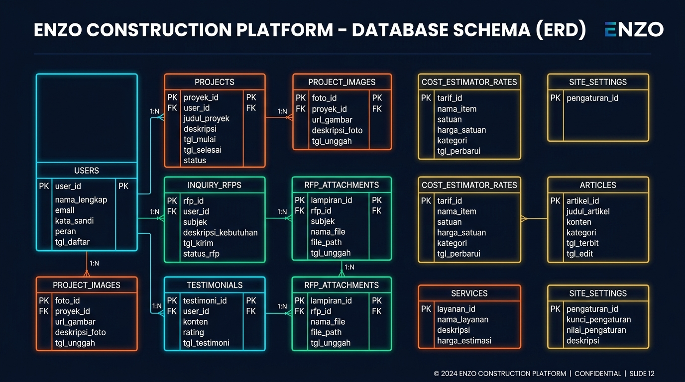

```mermaid
erDiagram
    USERS ||--o{ ARTICLES : "menulis"
    USERS ||--o{ INQUIRY_RFPS : "ditugaskan sebagai PIC"
    USERS ||--o{ RFP_NEGOTIATION_LOGS : "mencatat negosiasi"
    SERVICES ||--o{ PROJECTS : "mengelompokkan"
    PROJECTS ||--o{ PROJECT_IMAGES : "memiliki galeri"
    PROJECTS ||--o{ TESTIMONIALS : "diberi ulasan"
    
    DESIGN_LAYOUTS ||--o{ INQUIRY_RFPS : "menjadi acuan denah"
    INQUIRY_RFPS ||--o{ RFP_ATTACHMENTS : "memiliki berkas lampiran"
    INQUIRY_RFPS ||--o{ RFP_NEGOTIATION_LOGS : "memiliki riwayat negosiasi"
    INQUIRY_RFPS ||--o{ CONSTRUCTION_PROGRESS_LOGS : "memiliki jurnal mandor"
    INQUIRY_RFPS ||--o{ PROJECT_COMPLAINTS : "memiliki tiket komplain"

    USERS {
        bigint id PK
        string name "Nama User/Staf/Estimator"
        string email UK "Email login unik"
        timestamp email_verified_at "Waktu verifikasi"
        string password "Hash bcrypt"
        string role "admin | estimator | project_manager"
        string remember_token "Token remember me"
        timestamp created_at
        timestamp updated_at
    }

    SERVICES {
        bigint id PK
        string name "Nama layanan: Civil, Design & Build, dll"
        string slug UK "URL slug unik"
        string icon "Ikon Lucide/Tabler"
        string short_description "Deskripsi singkat"
        text full_description "Deskripsi komprehensif"
        string banner_image "Path gambar cover"
        int sort_order "Urutan prioritas tampil"
        boolean is_active "Status aktif"
        timestamp created_at
        timestamp updated_at
    }

    DESIGN_LAYOUTS {
        bigint id PK
        string code UK "Kode denah: LAY-T45, LAY-VILLA"
        string title "Judul denah: Minimalis Modern Tipe 45"
        string slug UK "URL slug unik"
        string architectural_style "modern_minimalist | scandinavian | luxury_classic"
        decimal building_area_sqm "Luas bangunan m2"
        decimal land_area_sqm "Luas tanah m2"
        int bedrooms_count "Jumlah kamar tidur"
        int bathrooms_count "Jumlah kamar mandi"
        int floors_count "Jumlah lantai"
        decimal estimated_cost_idr "Estimasi biaya pembangunan Rp"
        string floor_plan_image "Foto denah 2D blueprint"
        string render_3d_image "Foto render fasad 3D/AI"
        text specifications "Rincian spesifikasi ruang & struktur"
        boolean is_popular "Label denah favorit"
        timestamp created_at
        timestamp updated_at
    }

    PROJECTS {
        bigint id PK
        bigint service_id FK "Relasi ke services(id)"
        string title "Judul proyek konstruksi"
        string slug UK "URL slug unik"
        string client_name "Nama pemilik proyek/klien"
        string project_type "residential | commercial | industrial | civil"
        boolean is_residential "Penanda hunian pribadi untuk privasi"
        boolean client_privacy_consented "Izin publikasi data lengkap"
        string location "Lokasi fisik lengkap"
        decimal building_area_sqm "Luas bangunan m2"
        decimal land_area_sqm "Luas tanah m2"
        int completion_year "Tahun selesai"
        string duration "Durasi pengerjaan, mis: 8 Bulan"
        string status "completed | ongoing | planned"
        text challenge_description "Tantangan teknis lapangan"
        text solution_description "Solusi rekayasa yang diterapkan"
        boolean is_featured "Tampil di Beranda"
        int sort_order "Urutan tampil"
        timestamp created_at
        timestamp updated_at
    }

    PROJECT_IMAGES {
        bigint id PK
        bigint project_id FK "Relasi ke projects(id)"
        string image_path "Lokasi penyimpanan gambar"
        string caption "Keterangan foto proyek"
        string type "gallery | before | after | blueprint"
        int sort_order "Urutan foto"
        timestamp created_at
        timestamp updated_at
    }

    INQUIRY_RFPS {
        bigint id PK
        bigint design_layout_id FK "Relasi opsional ke design_layouts(id)"
        bigint assigned_to_user_id FK "Relasi penugasan staf PIC ke users(id)"
        string rfp_number UK "Nomor tiket unik: RFP-2610-001"
        string full_name "Nama pemohon tender/klien"
        string company_name "Nama instansi/perusahaan"
        string email "Email korespondensi"
        string phone_number "Nomor telepon/WhatsApp aktif"
        string project_category "Kategori: Bangun Baru, Renovasi, dll"
        string site_location "Alamat/lokasi lahan konstruksi"
        decimal estimated_budget_idr "Plafon anggaran Rp"
        decimal planned_area_sqm "Rencana luas bangunan m2"
        string payment_scheme "cash | cash_tempo | kpr_bank"
        text project_notes "Catatan lingkup pekerjaan"
        string status "submitted | in_review | contacted | survey_scheduled | rab_sent | deal | rejected"
        timestamp admin_last_viewed_at "Timestamp admin buka tiket (Penghenti Reminder)"
        decimal deal_amount_idr "Nilai kesepakatan akhir SPK"
        date deal_date "Tanggal penandatanganan SPK"
        int client_rating "Penilaian bintang kepuasan (1-5)"
        text client_review "Ulasan testimoni klien"
        boolean client_privacy_consented "Persetujuan publikasi portofolio"
        text internal_admin_notes "Catatan internal tim estimator"
        timestamp created_at
        timestamp updated_at
    }

    RFP_ATTACHMENTS {
        bigint id PK
        bigint inquiry_rfp_id FK "Relasi ke inquiry_rfps(id)"
        string original_filename "Nama asli file"
        string file_path "Path penyimpanan aman di server"
        string file_type "Tipe MIME: pdf, dwg, zip, jpg, png"
        unsigned_bigint file_size_bytes "Ukuran berkas dalam bytes"
        timestamp created_at
        timestamp updated_at
    }

    RFP_NEGOTIATION_LOGS {
        bigint id PK
        bigint inquiry_rfp_id FK "Relasi ke inquiry_rfps(id)"
        bigint user_id FK "Relasi ke users(id) pencatat"
        string stage "initial_proposal | spec_clarification | price_negotiation | revised_boq | final_deal"
        decimal proposed_amount_idr "Nilai penawaran/revisi anggaran"
        text client_notes "Catatan permintaan/keberatan klien"
        text admin_response "Tanggapan teknis tim estimator"
        timestamp created_at
        timestamp updated_at
    }

    CONSTRUCTION_PROGRESS_LOGS {
        bigint id PK
        bigint inquiry_rfp_id FK "Relasi ke inquiry_rfps(id)"
        int day_number "Jurnal progres: Hari ke-1, ke-15, dst"
        date logged_date "Tanggal opname fisik lapangan"
        string stage_name "Tahap: Pondasi, Sloof, Kolom, Atap, Finishing"
        decimal progress_percentage "Persentase fisik lapangan %"
        string physical_photo_url "Foto kondisi riil di lapangan"
        string ai_render_promised_url "Foto desain render 3D acuan janji"
        string weather_notes "Catatan cuaca (Cerah, Hujan Ringan, dll)"
        text notes "Laporan mandor & kendala teknis"
        string foreman_name "Nama mandor / pengawas lapangan"
        timestamp created_at
        timestamp updated_at
    }

    PROJECT_COMPLAINTS {
        bigint id PK
        bigint inquiry_rfp_id FK "Relasi ke inquiry_rfps(id)"
        string complaint_number UK "Nomor tiket: CMP-2610-001"
        string title "Judul keluhan ketidaksesuaian"
        string category "sanitasi | warna_cat_kusen | plafon_atap | keramik_lantai | instalasi_listrik | lainnya"
        text description "Rincian ketidaksesuaian fisik lapangan"
        string photo_evidence_url "Foto bukti ketidaksesuaian lapangan"
        string status "submitted | investigating | fixing | resolved"
        text resolution_notes "Tanggapan perbaikan & garansi kontraktor"
        timestamp resolved_at "Waktu penyelesaian komplain"
        timestamp created_at
        timestamp updated_at
    }

    COST_ESTIMATOR_RATES {
        bigint id PK
        string building_type "residential_standard | residential_luxury | warehouse | office | shophouse"
        string finish_grade "standard | premium | luxury"
        decimal base_price_per_sqm "Tarif dasar per m2 Rp"
        decimal multi_floor_multiplier "Koefisien lantai bertingkat"
        text specification_details "Rincian spek material teknis"
        boolean is_active "Status tarif berlaku"
        timestamp created_at
        timestamp updated_at
    }

    TESTIMONIALS {
        bigint id PK
        bigint project_id FK "Relasi opsional ke projects(id)"
        string client_name "Nama pemberi ulasan"
        string client_role "Jabatan / status"
        string company_name "Nama perusahaan klien"
        string avatar_image "Foto profil klien"
        text testimonial_text "Isi testimoni"
        int rating "Skor kepuasan (1 - 5)"
        boolean is_approved "Status moderasi tampil"
        timestamp created_at
        timestamp updated_at
    }

    ARTICLES {
        bigint id PK
        bigint user_id FK "Relasi ke users(id) penulis"
        string title "Judul wawasan konstruksi"
        string slug UK "URL slug unik"
        string category "edukasi | berita_proyek | teknologi_konstruksi"
        text content "Konten lengkap artikel"
        string cover_image "Gambar utama artikel"
        boolean is_published "Status terbit"
        timestamp published_at "Waktu terbit"
        timestamp created_at
        timestamp updated_at
    }

    SITE_SETTINGS {
        bigint id PK
        string setting_key UK "Kunci konfigurasi"
        text setting_value "Nilai konfigurasi"
        string group "company | contact | seo | social_media"
        timestamp created_at
        timestamp updated_at
    }
```

---

### 1.3 Kamus Data Lengkap (Data Dictionary)

#### 1. Entitas: `users`
Tabel penampung kredensial pengguna, autentikasi, serta pembagian hak akses (*Role-Based Access Control*).
| Nama Atribut | Tipe Data | Kunci | Nullable | Nilai Default | Keterangan / Fungsi Bisnis |
|---|---|:---:|:---:|---|---|
| `id` | BIGINT UNSIGNED | **PK** | Tidak | AUTO_INCREMENT | Identifikator unik pengguna |
| `name` | VARCHAR(255) | - | Tidak | - | Nama lengkap administrator / staf |
| `email` | VARCHAR(255) | **UK** | Tidak | - | Alamat email unik untuk login |
| `email_verified_at` | TIMESTAMP | - | Ya | NULL | Waktu verifikasi surel |
| `password` | VARCHAR(255) | - | Tidak | - | Hash sandi tersimpan (*bcrypt*) |
| `role` | VARCHAR(255) | - | Tidak | `'admin'` | Peran pengguna (`admin`, `estimator`, `editor`) |
| `remember_token` | VARCHAR(100) | - | Ya | NULL | Token sesi persistent Laravel |
| `created_at` | TIMESTAMP | - | Ya | CURRENT_TIMESTAMP | Waktu pendaftaran akun |
| `updated_at` | TIMESTAMP | - | Ya | CURRENT_TIMESTAMP | Waktu terakhir modifikasi akun |

#### 2. Entitas: `services`
Tabel katalog bidang jasa dan spesialisasi konstruksi yang disediakan oleh ENZO.
| Nama Atribut | Tipe Data | Kunci | Nullable | Nilai Default | Keterangan / Fungsi Bisnis |
|---|---|:---:|:---:|---|---|
| `id` | BIGINT UNSIGNED | **PK** | Tidak | AUTO_INCREMENT | Identifikator unik layanan |
| `name` | VARCHAR(255) | - | Tidak | - | Nama bidang layanan (cth: *Design & Build*, *Civil Work*) |
| `slug` | VARCHAR(255) | **UK** | Tidak | - | Slug URL ramah SEO |
| `icon` | VARCHAR(255) | - | Ya | NULL | Class atau identifier icon vektor |
| `short_description` | VARCHAR(255) | - | Ya | NULL | Ringkasan singkat untuk kartu beranda |
| `full_description` | TEXT | - | Ya | NULL | Penjelasan mendalam mengenai ruang lingkup pengerjaan |
| `banner_image` | VARCHAR(255) | - | Ya | NULL | Path gambar header resolusi tinggi |
| `sort_order` | INTEGER | - | Tidak | `0` | Angka urutan tampilan di antarmuka |
| `is_active` | BOOLEAN | - | Tidak | `true` | Status publikasi layanan |
| `created_at` / `updated_at` | TIMESTAMP | - | Ya | - | Audit trail waktu pembuatan dan pembaruan |

#### 3. Entitas: `projects`
Tabel portofolio proyek konstruksi fisik beserta data spesifikasi teknis, studi kasus, serta perlindungan privasi data hunian (Poin 10).
| Nama Atribut | Tipe Data | Kunci | Nullable | Nilai Default | Keterangan / Fungsi Bisnis |
|---|---|:---:|:---:|---|---|
| `id` | BIGINT UNSIGNED | **PK** | Tidak | AUTO_INCREMENT | Identifikator unik proyek |
| `service_id` | BIGINT UNSIGNED | **FK** | Tidak | - | Referensi ke `services(id)` dengan `cascadeOnDelete` |
| `title` | VARCHAR(255) | - | Tidak | - | Judul resmi proyek konstruksi |
| `slug` | VARCHAR(255) | **UK** | Tidak | - | Slug unik halaman detail proyek |
| `client_name` | VARCHAR(255) | - | Ya | NULL | Nama pemilik proyek / instansi klien |
| `project_type` | VARCHAR(255) | - | Tidak | `'residential'` | Kategori: `residential`, `commercial`, `industrial`, `civil` |
| `is_residential` | BOOLEAN | - | Tidak | `false` | **Poin 10**: Penanda hunian pribadi untuk memicu fitur masking privasi |
| `client_privacy_consented` | BOOLEAN | - | Tidak | `false` | **Poin 10**: Izin eksplisit pemilik hunian untuk menampilkan alamat asli |
| `location` | VARCHAR(255) | - | Ya | NULL | Alamat fisik lengkap di database |
| `building_area_sqm` | DECIMAL(10,2) | - | Ya | NULL | Luas total bangunan ($m^2$) |
| `land_area_sqm` | DECIMAL(10,2) | - | Ya | NULL | Luas lahan/tanah konstruksi ($m^2$) |
| `completion_year` | INTEGER | - | Ya | NULL | Tahun peresmian / serah terima pekerjaan |
| `duration` | VARCHAR(255) | - | Ya | NULL | Waktu pengerjaan (misal: *8 Bulan*) |
| `status` | VARCHAR(255) | - | Tidak | `'completed'` | Status progres (`completed`, `ongoing`, `planned`) |
| `challenge_description` | TEXT | - | Ya | NULL | Rintangan/kondisi tanah/lapangan yang dihadapi |
| `solution_description` | TEXT | - | Ya | NULL | Solusi rekayasa struktural & arsitektur dari Enzo |
| `is_featured` | BOOLEAN | - | Tidak | `false` | Penanda proyek unggulan di Beranda |
| `sort_order` | INTEGER | - | Tidak | `0` | Urutan penataan kartu portofolio |
| `created_at` / `updated_at` | TIMESTAMP | - | Ya | - | Audit trail sistem |

#### 4. Entitas: `project_images`
Tabel galeri dokumentasi foto proyek, termasuk foto perbandingan *Before & After* dan denah/blueprint.
| Nama Atribut | Tipe Data | Kunci | Nullable | Nilai Default | Keterangan / Fungsi Bisnis |
|---|---|:---:|:---:|---|---|
| `id` | BIGINT UNSIGNED | **PK** | Tidak | AUTO_INCREMENT | Identifikator unik foto |
| `project_id` | BIGINT UNSIGNED | **FK** | Tidak | - | Referensi ke `projects(id)` dengan `cascadeOnDelete` |
| `image_path` | VARCHAR(255) | - | Tidak | - | Lokasi penyimpanan berkas di disk storage server |
| `caption` | VARCHAR(255) | - | Ya | NULL | Keterangan foto (cth: *Tampak Fasad Malam*) |
| `type` | VARCHAR(255) | - | Tidak | `'gallery'` | Jenis foto: `gallery`, `before`, `after`, `blueprint` |
| `sort_order` | INTEGER | - | Tidak | `0` | Urutan geser foto pada slider/galeri |
| `created_at` / `updated_at` | TIMESTAMP | - | Ya | - | Audit trail sistem |

#### 5. Entitas: `inquiry_rfps`
Tabel inti penampung prospek tender, penugasan PIC, skema pembayaran, dan tracking pengingat admin.
| Nama Atribut | Tipe Data | Kunci | Nullable | Nilai Default | Keterangan / Fungsi Bisnis |
|---|---|:---:|:---:|---|---|
| `id` | BIGINT UNSIGNED | **PK** | Tidak | AUTO_INCREMENT | Identifikator unik pengajuan tender |
| `design_layout_id` | BIGINT UNSIGNED | **FK** | Ya | NULL | **Poin 2**: Relasi opsional ke denah siap pakai di `design_layouts(id)` |
| `assigned_to_user_id`| BIGINT UNSIGNED | **FK** | Ya | NULL | **Poin 5**: Relasi penugasan staf PIC ke `users(id)` |
| `rfp_number` | VARCHAR(255) | **UK** | Tidak | - | Kode tracking tiket (cth: `RFP-2610-001`) |
| `full_name` | VARCHAR(255) | - | Tidak | - | Nama lengkap narahubung calon klien |
| `company_name` | VARCHAR(255) | - | Ya | NULL | Nama perusahaan / badan usaha |
| `email` | VARCHAR(255) | - | Tidak | - | Alamat email resmi untuk pengiriman penawaran/RAB |
| `phone_number` | VARCHAR(255) | - | Tidak | - | Nomor WhatsApp aktif untuk konfirmasi cepat |
| `project_category` | VARCHAR(255) | - | Ya | NULL | Kategori pekerjaan (Bangun Baru, Renovasi, dll.) |
| `site_location` | VARCHAR(255) | - | Ya | NULL | Lokasi rencana tapak pembangunan |
| `estimated_budget_idr` | DECIMAL(15,2) | - | Ya | NULL | Estimasi pagu anggaran yang disiapkan calon klien |
| `planned_area_sqm` | DECIMAL(10,2) | - | Ya | NULL | Estimasi luas tanah atau bangunan ($m^2$) |
| `payment_scheme` | VARCHAR(255) | - | Tidak | `'cash'` | **Poin 6**: Opsi pembayaran: `cash`, `cash_tempo`, `kpr_bank` |
| `project_notes` | TEXT | - | Ya | NULL | Ringkasan penjelasan kebutuhan dan harapan klien |
| `status` | VARCHAR(255) | - | Tidak | `'submitted'` | Pipeline: `submitted`, `in_review`, `contacted`, `survey_scheduled`, `rab_sent`, `deal`, `rejected` |
| `admin_last_viewed_at` | TIMESTAMP | - | Ya | NULL | **Poin 4**: Waktu admin membuka tiket (penghenti reminder otomatis) |
| `deal_amount_idr` | DECIMAL(15,2) | - | Ya | NULL | Nilai kesepakatan final SPK setelah negosiasi |
| `deal_date` | DATE | - | Ya | NULL | Tanggal penandatanganan SPK |
| `client_rating` | INTEGER | - | Ya | NULL | **Poin 9**: Skor ulasan bintang klien (1 - 5) |
| `client_review` | TEXT | - | Ya | NULL | **Poin 9**: Testimoni kepuasan klien |
| `client_privacy_consented` | BOOLEAN | - | Tidak | `false` | **Poin 10**: Izin publikasi ulasan pada portofolio publik |
| `internal_admin_notes` | TEXT | - | Ya | NULL | Catatan analisis estimator / status negosiasi |
| `created_at` / `updated_at` | TIMESTAMP | - | Ya | - | Tanggal pengajuan dan pembaruan prospek |

#### 6. Entitas: `rfp_attachments`
Tabel penyimpanan berkas lampiran pendukung tender (dokumen TOR, gambar denah CAD/DWG, PDF BOQ).
| Nama Atribut | Tipe Data | Kunci | Nullable | Nilai Default | Keterangan / Fungsi Bisnis |
|---|---|:---:|:---:|---|---|
| `id` | BIGINT UNSIGNED | **PK** | Tidak | AUTO_INCREMENT | Identifikator unik berkas |
| `inquiry_rfp_id` | BIGINT UNSIGNED | **FK** | Tidak | - | Referensi ke `inquiry_rfps(id)` dengan `cascadeOnDelete` |
| `original_filename` | VARCHAR(255) | - | Tidak | - | Nama asli dokumen saat diunggah klien |
| `file_path` | VARCHAR(255) | - | Tidak | - | Path terenkripsi aman di `/storage/app/rfp_docs/` |
| `file_type` | VARCHAR(255) | - | Ya | NULL | Ekstensi / MIME type (pdf, dwg, zip, dll) |
| `file_size_bytes` | UNSIGNED BIGINT | - | Tidak | `0` | Ukuran berkas dalam satuan byte |
| `created_at` / `updated_at` | TIMESTAMP | - | Ya | - | Audit trail pengunggahan berkas |

#### 7. Entitas Baru: `design_layouts` (Poin 2 Evaluasi Dosen)
Tabel katalog referensi desain dan denah tata letak siap pakai bagi konsumen yang belum memiliki rancangan sendiri.
| Nama Atribut | Tipe Data | Kunci | Nullable | Nilai Default | Keterangan / Fungsi Bisnis |
|---|---|:---:|:---:|---|---|
| `id` | BIGINT UNSIGNED | **PK** | Tidak | AUTO_INCREMENT | Identifikator unik layout denah |
| `code` | VARCHAR(255) | **UK** | Tidak | - | Kode inventori denah (cth: `LAY-T45`, `LAY-VILLA`) |
| `title` | VARCHAR(255) | - | Tidak | - | Judul denah (cth: *Minimalis Modern Tipe 45*) |
| `slug` | VARCHAR(255) | **UK** | Tidak | - | Slug URL ramah SEO |
| `architectural_style` | VARCHAR(255) | - | Tidak | `'modern_minimalist'` | Gaya arsitektur bangunan |
| `building_area_sqm` | DECIMAL(8,2) | - | Tidak | - | Luas bangunan standar ($m^2$) |
| `land_area_sqm` | DECIMAL(8,2) | - | Tidak | - | Kebutuhan luas kavling tanah ($m^2$) |
| `bedrooms_count` | INTEGER | - | Tidak | `2` | Jumlah kamar tidur |
| `bathrooms_count` | INTEGER | - | Tidak | `1` | Jumlah kamar mandi / toilet |
| `floors_count` | INTEGER | - | Tidak | `1` | Jumlah lantai bangunan |
| `estimated_cost_idr` | DECIMAL(15,2) | - | Tidak | - | Estimasi biaya konstruksi standar (Rp) |
| `floor_plan_image` | VARCHAR(255) | - | Ya | NULL | Path gambar denah tata letak 2D arsitektural |
| `render_3d_image` | VARCHAR(255) | - | Ya | NULL | Path gambar render visualisasi 3D fasad |
| `specifications` | TEXT | - | Ya | NULL | Rincian pembagian ruang & material kunci |
| `is_popular` | BOOLEAN | - | Tidak | `false` | Badge denah terfavorit / rekomendasi |
| `created_at` / `updated_at` | TIMESTAMP | - | Ya | - | Audit trail sistem |

#### 8. Entitas Baru: `rfp_negotiation_logs` (Poin 5 Evaluasi Dosen)
Tabel riwayat proses negosiasi harga dan spesifikasi teknis material dari proposal awal hingga penandatanganan SPK *Deal*.
| Nama Atribut | Tipe Data | Kunci | Nullable | Nilai Default | Keterangan / Fungsi Bisnis |
|---|---|:---:|:---:|---|---|
| `id` | BIGINT UNSIGNED | **PK** | Tidak | AUTO_INCREMENT | Identifikator unik catatan negosiasi |
| `inquiry_rfp_id` | BIGINT UNSIGNED | **FK** | Tidak | - | Referensi ke `inquiry_rfps(id)` dengan `cascadeOnDelete` |
| `user_id` | BIGINT UNSIGNED | **FK** | Tidak | - | Staf estimator penanggung jawab rekam jejak |
| `stage` | VARCHAR(255) | - | Tidak | `'spec_clarification'` | Tahap: `initial_proposal`, `spec_clarification`, `price_negotiation`, `revised_boq`, `final_deal` |
| `proposed_amount_idr`| DECIMAL(15,2) | - | Ya | NULL | Anggaran revisi atau plafon yang dinegosiasikan (Rp) |
| `client_notes` | TEXT | - | Ya | NULL | Catatan permintaan, diskon, atau revisi dari calon klien |
| `admin_response` | TEXT | - | Tidak | - | Tanggapan teknis dan penyesuaian BOQ dari tim kontraktor |
| `created_at` / `updated_at` | TIMESTAMP | - | Ya | - | Audit trail waktu diskusi perundingan |

#### 9. Entitas Baru: `construction_progress_logs` (Poin 7 Evaluasi Dosen)
Tabel jurnal harian pengawasan mandor lapangan yang menyandingkan visual foto Render 3D vs Kondisi Nyata di lapangan.
| Nama Atribut | Tipe Data | Kunci | Nullable | Nilai Default | Keterangan / Fungsi Bisnis |
|---|---|:---:|:---:|---|---|
| `id` | BIGINT UNSIGNED | **PK** | Tidak | AUTO_INCREMENT | Identifikator unik jurnal mandor |
| `inquiry_rfp_id` | BIGINT UNSIGNED | **FK** | Tidak | - | Referensi ke proyek tender di `inquiry_rfps(id)` |
| `day_number` | INTEGER | - | Tidak | - | Nomor hari pengerjaan (Hari Ke-1, Ke-15, Ke-35, dst.) |
| `logged_date` | DATE | - | Tidak | - | Tanggal opname fisik lapangan dilakukan |
| `stage_name` | VARCHAR(255) | - | Tidak | - | Tahap pekerjaan: Pondasi, Pembesian Sloof, Kolom, Atap, Finishing |
| `progress_percentage`| DECIMAL(5,2) | - | Tidak | `0.00` | Persentase kumulatif penyelesaian fisik (%) |
| `physical_photo_url` | VARCHAR(255) | - | Ya | NULL | Foto dokumentasi nyata hasil opname fisik di proyek |
| `ai_render_promised_url`| VARCHAR(255) | - | Ya | NULL | Foto render 3D / AI desain acuan yang dijanjikan dalam SPK |
| `weather_notes` | VARCHAR(255) | - | Ya | NULL | Kondisi cuaca (Cerah, Hujan Siang Hari, dll.) |
| `notes` | TEXT | - | Ya | NULL | Catatan mandor mengenai volume tukang dan mutu kerja |
| `foreman_name` | VARCHAR(255) | - | Ya | NULL | Nama mandor / pengawas lapangan yang bertugas |
| `created_at` / `updated_at` | TIMESTAMP | - | Ya | - | Audit trail pencatatan laporan |

#### 10. Entitas Baru: `project_complaints` (Poin 8 Evaluasi Dosen)
Tabel penampung tiket pengaduan / komplain garansi mutu pengerjaan jika fisik lapangan tidak sesuai kesepakatan awal.
| Nama Atribut | Tipe Data | Kunci | Nullable | Nilai Default | Keterangan / Fungsi Bisnis |
|---|---|:---:|:---:|---|---|
| `id` | BIGINT UNSIGNED | **PK** | Tidak | AUTO_INCREMENT | Identifikator unik komplain |
| `inquiry_rfp_id` | BIGINT UNSIGNED | **FK** | Tidak | - | Referensi ke tiket proyek di `inquiry_rfps(id)` |
| `complaint_number` | VARCHAR(255) | **UK** | Tidak | - | Nomor tiket unik pengaduan (cth: `CMP-2610-001`) |
| `title` | VARCHAR(255) | - | Tidak | - | Ringkasan pokok keluhan (cth: *Posisi Kloset WC Geser 30cm*) |
| `category` | VARCHAR(255) | - | Tidak | `'sanitasi'` | Kategori: `sanitasi`, `warna_cat_kusen`, `plafon_atap`, `keramik_lantai`, `instalasi_listrik`, `lainnya` |
| `description` | TEXT | - | Tidak | - | Rincian detail ketidaksesuaian yang dikeluhkan konsumen |
| `photo_evidence_url` | VARCHAR(255) | - | Ya | NULL | Foto bukti ketidaksesuaian fisik yang diambil konsumen |
| `status` | VARCHAR(255) | - | Tidak | `'submitted'` | Status penanganan: `submitted`, `investigating`, `fixing`, `resolved` |
| `resolution_notes` | TEXT | - | Ya | NULL | Laporan tindakan perbaikan dan klaim garansi dari kontraktor |
| `resolved_at` | TIMESTAMP | - | Ya | NULL | Waktu penuntasan komplain oleh mandor/estimator |
| `created_at` / `updated_at` | TIMESTAMP | - | Ya | - | Audit trail pengaduan konsumen |

#### 11. Entitas: `cost_estimator_rates`
Tabel acuan tarif simulasi anggaran pembangunan pada kalkulator interaktif.
| Nama Atribut | Tipe Data | Kunci | Nullable | Nilai Default | Keterangan / Fungsi Bisnis |
|---|---|:---:|:---:|---|---|
| `id` | BIGINT UNSIGNED | **PK** | Tidak | AUTO_INCREMENT | Identifikator tarif |
| `building_type` | VARCHAR(255) | - | Tidak | - | Tipe: `residential_standard`, `residential_luxury`, `warehouse`, `office`, `shophouse` |
| `finish_grade` | VARCHAR(255) | - | Tidak | `'standard'` | Tingkat spesifikasi: `standard`, `premium`, `luxury` |
| `base_price_per_sqm` | DECIMAL(12,2) | - | Tidak | - | Harga acuan per $m^2$ (Rp) |
| `multi_floor_multiplier`| DECIMAL(5,2) | - | Tidak | `1.00` | Koefisien pengali struktur tingkat tambahan |
| `specification_details` | TEXT | - | Ya | NULL | Spesifikasi teknis (pondasi, finishing, sanitair) |
| `is_active` | BOOLEAN | - | Tidak | `true` | Status keaktifan tarif |
| `created_at` / `updated_at` | TIMESTAMP | - | Ya | - | Audit trail pembaruan harga acuan |

#### 12. Entitas: `testimonials`
Tabel ulasan autentik kepuasan dari klien korporat maupun perorangan.
| Nama Atribut | Tipe Data | Kunci | Nullable | Nilai Default | Keterangan / Fungsi Bisnis |
|---|---|:---:|:---:|---|---|
| `id` | BIGINT UNSIGNED | **PK** | Tidak | AUTO_INCREMENT | Identifikator ulasan |
| `project_id` | BIGINT UNSIGNED | **FK** | Ya | NULL | Referensi ke `projects(id)` dengan `nullOnDelete` |
| `client_name` | VARCHAR(255) | - | Tidak | - | Nama pemberi ulasan |
| `client_role` | VARCHAR(255) | - | Ya | NULL | Jabatan / wewenang (cth: *Project Director*) |
| `company_name` | VARCHAR(255) | - | Ya | NULL | Nama perusahaan / entitas pemilik proyek |
| `avatar_image` | VARCHAR(255) | - | Ya | NULL | Foto profil klien pemberi ulasan |
| `testimonial_text` | TEXT | - | Tidak | - | Teks ulasan pengalaman kerja sama |
| `rating` | INTEGER | - | Tidak | `5` | Nilai bintang kepuasan (skala 1 - 5) |
| `is_approved` | BOOLEAN | - | Tidak | `false` | Moderasi persetujuan tampil di web publik |
| `created_at` / `updated_at` | TIMESTAMP | - | Ya | - | Audit trail ulasan |

#### 13. Entitas: `articles`
Tabel publikasi wawasan rekayasa, metode kerja konstruksi, dan kabar korporasi.
| Nama Atribut | Tipe Data | Kunci | Nullable | Nilai Default | Keterangan / Fungsi Bisnis |
|---|---|:---:|:---:|---|---|
| `id` | BIGINT UNSIGNED | **PK** | Tidak | AUTO_INCREMENT | Identifikator artikel |
| `user_id` | BIGINT UNSIGNED | **FK** | Tidak | - | Referensi ke `users(id)` penulis dengan `cascadeOnDelete` |
| `title` | VARCHAR(255) | - | Tidak | - | Judul wawasan / artikel |
| `slug` | VARCHAR(255) | **UK** | Tidak | - | URL slug unik ramah SEO |
| `category` | VARCHAR(255) | - | Tidak | `'edukasi'` | Kategori: `edukasi`, `berita_proyek`, `teknologi_konstruksi` |
| `content` | TEXT | - | Tidak | - | Isi lengkap tulisan / artikel |
| `cover_image` | VARCHAR(255) | - | Ya | NULL | Gambar sampul artikel |
| `is_published` | BOOLEAN | - | Tidak | `false` | Penanda status tayang publik |
| `published_at` | TIMESTAMP | - | Ya | NULL | Waktu publikasi resmi |
| `created_at` / `updated_at` | TIMESTAMP | - | Ya | - | Audit trail konten |

#### 14. Entitas: `site_settings`
Tabel dinamis penyimpanan parameter global aplikasi (*key-value store*).
| Nama Atribut | Tipe Data | Kunci | Nullable | Nilai Default | Keterangan / Fungsi Bisnis |
|---|---|:---:|:---:|---|---|
| `id` | BIGINT UNSIGNED | **PK** | Tidak | AUTO_INCREMENT | Identifikator setelan |
| `setting_key` | VARCHAR(255) | **UK** | Tidak | - | Kode unik setelan (mis: `company_whatsapp`, `office_address`) |
| `setting_value` | TEXT | - | Ya | NULL | Nilai konten setelan |
| `group` | VARCHAR(255) | - | Tidak | `'company'` | Kelompok: `company`, `contact`, `seo`, `social_media` |
| `created_at` / `updated_at` | TIMESTAMP | - | Ya | - | Audit trail konfigurasi |

---

### 1.4 Aturan Integritas Referensial & Normalisasi Basis Data
1. **Aturan Hapus Berkaskad (*Cascade on Delete*)**:
   - Jika suatu entitas `services` dihapus, seluruh relasi `projects` di bawahnya terhapus secara otomatis guna menjaga integritas kategori.
   - Jika suatu entitas `projects` dihapus, seluruh foto pendukung di `project_images` terhapus otomatis (`cascadeOnDelete`).
   - Jika suatu pengajuan `inquiry_rfps` dihapus, seluruh berkas lampirannya di `rfp_attachments` ikut terhapus.
2. **Aturan Null on Delete**:
   - Jika sebuah entitas `projects` dihapus, referensi pada `testimonials` (`project_id`) diubah menjadi `NULL` (`nullOnDelete`), sehingga data testimoni kepuasan klien tetap tersimpan dan tidak hilang.
3. **Penerapan Normalisasi 3NF**:
   - **1NF**: Setiap kolom menyimpan nilai atomik tunggal (tidak ada multi-value column).
   - **2NF**: Seluruh atribut non-kunci bergantung secara fungsional penuh terhadap *Primary Key*.
   - **3NF**: Tidak terdapat ketergantungan transitif antar atribut non-kunci (contoh: kalkulator tarif diletakkan pada tabel terpisah `cost_estimator_rates` dan tidak digabungkan ke tabel `projects` atau `inquiries`).

---

# BAGIAN 2: WIREFRAME ANTARMUKA UI/UX

### 2.1 Konsep & Prinsip Desain UI/UX
Untuk membangun citra kontraktor profesional berkelas internasional (*high-end general contractor*), rancangan antarmuka ENZO menganut prinsip:
- **Visual Hierarchy 5 Detik**: Calon klien langsung memahami kapabilitas dan kredibilitas Enzo dalam 5 detik pertama membuka beranda.
- **Arsitektural & Kokoh**: Tipografi presisi (Plus Jakarta Sans / Josefin Sans), palet warna dominan *Deep Charcoal Slate* (`#0f172a`), aksen *Architectural Gold* (`#eab308` / `#f59e0b`), dan latar bersih.
- **Conversion-Driven Flow**: Tombol pemicu tindakan (CTA) tersebar strategis menuju formulir RFP dan saluran WhatsApp resmi.

#### Desain Visual & Wireframe Landing Page Baku (Gaya PT MKP Style):
> **Status Desain**: **DISETUJUI (APPROVED)** sebagai acuan baku visual antarmuka Beranda ENZO Construction.  
> **Karakteristik**: Visual sinematik luas (*full-bleed*), tipografi arsitektural elegan, kartu mengambang (*floating glass cards*), dan showcase layanan berbasis fotografi proyek mewah.

##### 1. Desain Mockup High-Fidelity Beranda (PT MKP Style Approved):
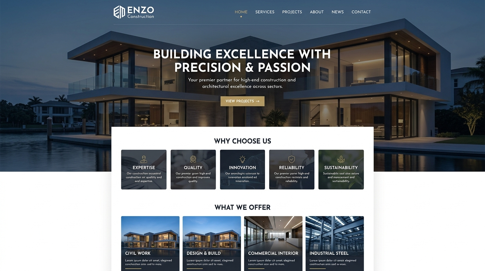

##### 2. Blueprint Wireframe Antarmuka Arsitektural:
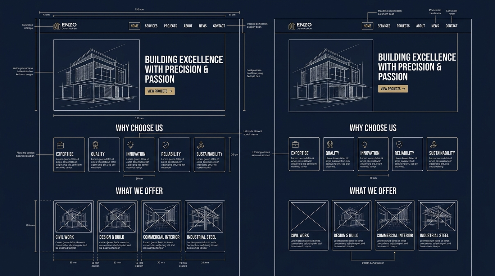

---

### 2.2 Wireframe 1: Beranda (Landing Page — Sesuai Mockup PT MKP Style)

```text
+--------------------------------------------------------------------------------------------------+
| [LOGO ENZO CONSTRUCTION]                      HOME   SERVICES   PROJECTS   ABOUT   NEWS   CONTACT|
+--------------------------------------------------------------------------------------------------+
| HERO SECTION (Full-Bleed Architectural High-Resolution Photography)                              |
|                                                                                                  |
|                      BUILDING EXCELLENCE WITH PRECISION & PASSION                                |
|                                                                                                  |
|            Your premier partner for high-end construction and architectural                      |
|                                excellence across sectors.                                        |
|                                                                                                  |
|                                  [ VIEW PROJECTS -> ]                                            |
|                                                                                                  |
+--------------------------------------------------------------------------------------------------+
| SECTION: WHY CHOOSE US (5 Kartu Visual Floating Berlatar Gelap & Ikon Aksen Emas)                |
| +----------------+ +----------------+ +----------------+ +----------------+ +------------------+ |
| | [ EXPERTISE ]  | | [ QUALITY ]    | | [ INNOVATION ] | | [RELIABILITY]  | | [SUSTAINABILITY] | |
| | Tenaga ahli    | | Standar mutu   | | Metode rekayasa| | Pengerjaan     | | Desain ramah     | |
| | bersertifikasi | | ISO 9001:2015  | | modern & BIM   | | on-time sesuai | | lingkungan &     | |
| | & berpengalaman| | & material top | | presisi digital| | pagu anggaran  | | efisiensi energi | |
| +----------------+ +----------------+ +----------------+ +----------------+ +------------------+ |
+--------------------------------------------------------------------------------------------------+
| SECTION: WHAT WE OFFER (Showcase 4 Layanan Berbasis Fotografi Arsitektur Mewah)                  |
| +-------------------------+ +-------------------------+ +--------------------------------------+ |
| | [FOTO PROYEK 1]         | | [FOTO PROYEK 2]         | | [FOTO PROYEK 3]     | [FOTO PROYEK 4]| |
| | CIVIL WORK              | | DESIGN & BUILD          | | COMMERCIAL INTERIOR | INDUSTRIAL     | |
| | Gedung bertingkat,      | | Dari konsep denah       | | Fit-out kantor,     | STEEL          | |
| | pondasi & infrastruktur | | hingga serah terima     | | hotel & komersial   | Struktur baja  | |
| | [Pelajari Selengkapnya] | | [Pelajari Selengkapnya] | | [Selengkapnya]      | & pergudangan  | |
| +-------------------------+ +-------------------------+ +--------------------------------------+ |
+--------------------------------------------------------------------------------------------------+
| PROYEK UNGGULAN & SLIDER BEFORE-AFTER INTERAKTIF                                                 |
| +----------------------------------------------------------------------------------------------+ |
| | Judul Proyek: Menara Perkantoran SCBD Horizon | Status: Selesai (2025)                       | |
| | [<<<<<< GESER SLIDER SEBELUM (BEFORE) / SESUDAH (AFTER) RENOVASI STRUKTUR FASAD >>>>>>]     | |
| | Spesifikasi: Luas 14.500 m2 | Waktu Pengerjaan: 14 Bulan | Nilai: Commercial Grade A         | |
| +----------------------------------------------------------------------------------------------+ |
+--------------------------------------------------------------------------------------------------+
| TRUST & CERTIFICATIONS (Logo Sertifikasi Resmi & Asosiasi Konstruksi)                            |
| [Logo LPJK / GAPENSI]   [Logo ISO 9001:2015]   [Sertifikasi K3 Kemenaker]   [SBU Konstruksi]     |
+--------------------------------------------------------------------------------------------------+
| FOOTER ELEGAN & KONTAK RESMI                                                                     |
| PT ENZO KARYA KONSTRUKSI | Sudirman Kav. XX, Jakarta | Telp: (021) 555-ENZO | info@enzo.id       |
+--------------------------------------------------------------------------------------------------+
| [FLOATING WHATSAPP FAST-RESPONSE BUTTON (Pojok Kanan Bawah)]                                     |
+--------------------------------------------------------------------------------------------------+
```

---

### 2.3 Wireframe 2: Portofolio Proyek & Fitur Before-After

```text
+--------------------------------------------------------------------------------------------------+
| HEADER HALAMAN PORTOFOLIO PROYEK                                                                 |
| "Katalog Studi Kasus & Rekam Jejak Konstruksi Terverifikasi"                                     |
+--------------------------------------------------------------------------------------------------+
| BILAH FILTER & PENCARIAN (Interactive Filter Bar)                                                |
| Kategori: [Semua] [Gedung Komersial] [Residensial Mewah] [Pabrik & Gudang] [Pekerjaan Sipil]    |
| Status  : [Semua] [Telah Selesai (Completed)] [Sedang Berjalan (Ongoing)]                        |
| Cari    : [ Cari berdasarkan nama proyek atau kota...                      ] [CARI]             |
+--------------------------------------------------------------------------------------------------+
| GRID DAFTAR PORTOFOLIO PROYEK                                                                    |
| +-----------------------------+ +-----------------------------+ +------------------------------+ |
| | [FOTO PROYEK 1]             | | [FOTO PROYEK 2]             | | [FOTO PROYEK 3]              | |
| | Eco Warehouse Cikarang      | | Villa Modern Canggu         | | Gedung Medika Harmoni        | |
| | Kategori: Industri & Baja   | | Kategori: Residensial Mewah | | Kategori: Komersial Publik   | |
| | Luas: 8.500 m2 | Lokasi: JBB| | Luas: 750 m2 | Lokasi: Bali | | Luas: 4.200 m2 | Lokasi: JKT | |
| | Status: [SELESAI]           | | Status: [SEDANG BERJALAN]   | | Status: [SELESAI]            | |
| | [ LIHAT STUDI KASUS -> ]    | | [ LIHAT STUDI KASUS -> ]    | | [ LIHAT STUDI KASUS -> ]     | |
| +-----------------------------+ +-----------------------------+ +------------------------------+ |
+--------------------------------------------------------------------------------------------------+
| MODAL / DETAIL STUDI KASUS PROYEK (Ketika Salah Satu Proyek Diklik)                              |
| +----------------------------------------------------------------------------------------------+ |
| | JUDUL: Revitalisasi Fasad & Struktur Menara Komersial Sudirman                               | |
| | Klien: PT Artha Graha Makmur | Lokasi: Jakarta Pusat | Luas Bangunan: 12.000 m2              | |
| |                                                                                              | |
| | FITUR INTERAKTIF SLIDER BEFORE & AFTER:                                                      | |
| | +------------------------------------------------------------------------------------------+ | |
| | | [FOTO SEBELUM (Kondisi Awal)]  <--- | DRAG DIVIDER | --->  [FOTO SESUDAH (Hasil Akhir)] | |
| | +------------------------------------------------------------------------------------------+ | |
| |                                                                                              | |
| | TANTANGAN LAPANGAN (*Engineering Challenges*):                                              | |
| | - Kondisi struktur pondasi lama mengalami penurunan diferensial 4 cm.                        | |
| | - Aktivitas gedung perkantoran tidak boleh terhenti selama renovasi berlangsung.            | |
| |                                                                                              | |
| | SOLUSI REKAYASA ENZO (*Structural Solutions*):                                               | |
| | - Penguatan struktur menggunakan metode Carbon Fiber Reinforced Polymer (CFRP).             | |
| | - Penjadwalan pekerjaan heavy-lifting pada malam hari dengan protokol K3 ketat.             | |
| |                                                                                              | |
| | [ TOMBOL: AJUKAN PROYEK SEJENIS DENGAN KAMI ]       [ TUTUP JENDELA DETAIL (X) ]             | |
| +----------------------------------------------------------------------------------------------+ |
+--------------------------------------------------------------------------------------------------+
```

---

### 2.4 Wireframe 3: Kalkulator Estimasi Biaya Bangun (RAB Interaktif)

```text
+--------------------------------------------------------------------------------------------------+
| KALKULATOR ESTIMASI BIAYA BANGUN (RAB AWAL INTERAKTIF)                                           |
| "Dapatkan Estimasi Biaya Kasar Konstruksi Anda Secara Instan Sebelum Konsultasi Mendalam"        |
+--------------------------------------------------------------------------------------------------+
| LANGKAH 1: PILIH JENIS BANGUNAN                                                                  |
| (o) Rumah Tinggal Standar    ( ) Rumah Mewah / Villa    ( ) Gedung Perkantoran                   |
| ( ) Gudang / Bangunan Baja   ( ) Ruko / Shophouse Komersial                                      |
+--------------------------------------------------------------------------------------------------+
| LANGKAH 2: TENTUKAN TINGKAT SPESIFIKASI MATERIAL (FINISH GRADE)                                  |
| [ ] STANDAR (Rp 4.5 - 5.5 Jt/m2)   : Struktur SNI, Lantai Granit 60x60, Cat Standar              |
| [*] PREMIUM (Rp 6.0 - 8.5 Jt/m2)   : Dinding Bata Ringan/Merah, Granit Tile 80x80, Sanitair Toto |
| [ ] LUXURY  (Rp 9.0 - 15.0+ Jt/m2) : Marmer Import, Smart Home, Facade Kaca Low-E, Sanitair Kohler|
+--------------------------------------------------------------------------------------------------+
| LANGKAH 3: INPUT DIMENSI BANGUNAN                                                                |
| Luas Rencana Bangunan (m2): [ 250 ] m2     <---[SLIDER INTERAKTIF 50 m2 s/d 5.000 m2]--->         |
| Jumlah Lantai             : [ 2   ] Lantai (Termasuk Koefisien Pengali Struktur Bertingkat)      |
+--------------------------------------------------------------------------------------------------+
| HASIL ESTIMASI BIAYA SECARA REAL-TIME                                                            |
| +----------------------------------------------------------------------------------------------+ |
| | ESTIMASI KISARAN BIAYA KONSTRUKSI AWAL:                                                      | |
| |                                                                                              | |
| |              Rp 1.650.000.000  —  Rp 1.950.000.000                                           | |
| |                                                                                              | |
| | Catatan: Estimasi di atas merupakan perkiraan kasar non-kontraktual. Nilai riil ditentukan   | |
| | oleh hasil penyelidikan tanah (Sondir), gambar DED arsitektur, dan rincian spesifikasi BOQ.  | |
| +----------------------------------------------------------------------------------------------+ |
| PILIHAN TINDAK LANJUT:                                                                           |
| [ TOMBOL: KONSULTASIKAN ESTIMASI INI KE FORM RFP ]  [ KIRIM HASIL ESTIMASI LANGSUNG VIA WHATSAPP ]|
+--------------------------------------------------------------------------------------------------+
```

---

### 2.5 Wireframe 4: Formulir Pengajuan Penawaran Tender (RFP)

```text
+--------------------------------------------------------------------------------------------------+
| FORMULIR PENGAJUAN PERMINTAAN PENAWARAN & TENDER (REQUEST FOR PROPOSAL)                          |
| "Kirimkan Kerangka Proyek Anda. Tim Estimator Kami Akan Menghubungi dalam 1x24 Jam Kerja"        |
+--------------------------------------------------------------------------------------------------+
| BAGIAN 1: IDENTITAS PEMOHON                                                                      |
| Nama Lengkap Penanggung Jawab*: [ Ir. Budi Santoso, M.T.                           ]             |
| Nama Perusahaan / Instansi    : [ PT Graha Mega Persada                            ]             |
| Nomor WhatsApp Aktif*         : [ 0812-3456-7890                                   ]             |
| Alamat Email Resmi*           : [ budi@graha-megapersada.co.id                     ]             |
+--------------------------------------------------------------------------------------------------+
| BAGIAN 2: RUANG LINGKUP & SPESIFIKASI PROYEK                                                     |
| Kategori Pekerjaan*:    [ Dropdown: Pembangunan Gedung Baru                       v ]             |
| Lokasi Tapak Proyek*:   [ Kawasan Industri KIIC, Karawang Barat, Jawa Barat        ]             |
| Perkiraan Luas Bangunan:[ 2400 ] m2             Rencana Mulai: [ 1-2 Bulan Mendatang v ]         |
| Alokasi Plafon Anggaran:[ Rp 12.000.000.000 (Opsional)                             ]             |
+--------------------------------------------------------------------------------------------------+
| BAGIAN 3: UNGGAH DOKUMEN TENDER / GAMBAR ARSITEKTUR (BILA TERSEDIA)                              |
| +----------------------------------------------------------------------------------------------+ |
| |   [IKON AWAN UPLOAD] DRAG & DROP BERKAS DOKUMEN TENDER ANDA DI SINI                          | |
| |   Format didukung: PDF, DWG (AutoCAD), ZIP, RAR, JPG, PNG (Maksimal Ukuran 25 MB)            | |
| |   [PILIH FILE DARI KOMPUTER] -> file terpilih: "TOR_Pabrik_Karawang_Rev02.pdf (4.2 MB)"      | |
| +----------------------------------------------------------------------------------------------+ |
| Catatan / Lingkup Pekerjaan Khusus:                                                              |
| [ Mohon disertakan penawaran pekerjaan struktur baja WF dan lantai cor epoxy heavy duty... ]     |
+--------------------------------------------------------------------------------------------------+
| [X] Saya bersedia dihubungi oleh tim teknis Enzo untuk koordinasi jadwal survey lokasi.          |
|                                                                                                  |
| [ TOMBOL CTA: SUBMIT PENGAJUAN PENAWARAN (RFP) SEKARANG ]                                        |
+--------------------------------------------------------------------------------------------------+
```

---

### 2.6 Wireframe 5: Dashboard Admin CMS & Lead Pipeline Tracker

#### Desain Mockup Admin CMS Dashboard:
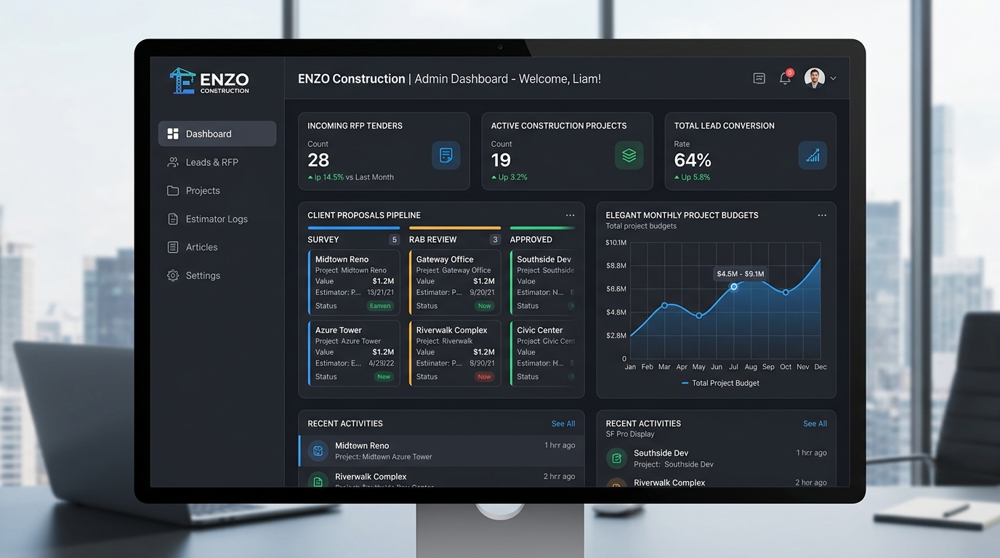

```text
+--------------------------------------------------------------------------------------------------+
| ENZO CMS PANEL | [Dashboard] [Manajemen RFP] [Portofolio] [Layanan] [Testimoni] [Pengaturan]     |
| Login Sebagai: Ahmad Fajar (Lead Estimator)                                    [ Profil ] [Logout]|
+--------------------------------------------------------------------------------------------------+
| RINGKASAN PROSPEK & AKTIVITAS TENDER (Statistik Real-time)                                       |
| +------------------+ +------------------+ +------------------+ +------------------+ +-----------+ |
| | [RFP BARU]       | | [SURVEY TERJADWAL| | [RAB TERKIRIM]   | | [DEAL KONTRAK]   | | [CLOSING] | |
| |   14 Tiket       | |   5 Lokasi       | |   8 Proposal     | |   3 Proyek       | |  Rp 24.5 M| |
| +------------------+ +------------------+ +------------------+ +------------------+ +-----------+ |
+--------------------------------------------------------------------------------------------------+
| DAFTAR PERMINTAAN TENDER / RFP MASUK (Pipeline Tracking)                                         |
| Filter Status: [Semua] [Baru] [Dihubungi] [Survey Dijadwalkan] [RAB Terkirim] [Deal] [Ditolak]   |
| +--------------+-------------------------+------------------+-----------+-----------+----------+ |
| | NO. TIKET    | NAMA KLIEN & INSTANSI   | TIPE & LOKASI    | LAMPIRAN  | STATUS    | AKSI     | |
| +--------------+-------------------------+------------------+-----------+-----------+----------+ |
| | RFP-2610-001 | PT Graha Mega Persada   | Pabrik Baja      | [TOR.pdf] | [Baru]    | [Lihat]  | |
| |              | Ir. Budi (0812-3456-xx) | Karawang (2400m2)| (4.2 MB)  |           | [WA Chat]| |
| +--------------+-------------------------+------------------+-----------+-----------+----------+ |
| | RFP-2610-002 | Ibu Clarissa Tan        | Hunian Mewah     | [Denah]   | [Survey   | [Lihat]  | |
| |              | Pribadi (0818-9988-xx)  | PIK 2 (650m2)    | (12.1 MB) |  Terjadwl]| [WA Chat]| |
| +--------------+-------------------------+------------------+-----------+-----------+----------+ |
| Fitur Cepat: Klik [WA Chat] membuka WhatsApp Web dengan template konfirmasi resmi otomatis!      |
+--------------------------------------------------------------------------------------------------+
| PANEL MANAJEMEN PORTOFOLIO PROYEK                                                                |
| [ + TAMBAH PROYEK BARU ]                                                                         |
| Daftar Proyek:                                                                                   |
| 1. Menara Mandiri Sudirman (Komersial) | Featured: [YA]  | Foto: 12 Gambar | [Edit] [Galeri]     |
| 2. Eco Warehouse Cikarang  (Industri)  | Featured: [TIDAK]| Foto: 8 Gambar  | [Edit] [Galeri]     |
+--------------------------------------------------------------------------------------------------+
```

---

### 2.7 Wireframe 6: Katalog Referensi Desain & Pemilihan Denah Tata Letak Siap Pakai (Poin 2)

```text
+--------------------------------------------------------------------------------------------------+
| ENZO CONTRACTOR | [Home] [Services] [Portfolio] [DESIGNS] [SPECS] [Cost Calculator] [RFP]       |
+--------------------------------------------------------------------------------------------------+
| HEADER: KATALOG REFERENSI DESAIN & DENAH SIAP PAKAI                                              |
| "Konsumen Bingung Menentukan Denah Sendiri? Pilih Denah Teruji Kami atau Unggah Desain Custom"   |
|                                                                                                  |
| Filter Tipe: [Semua Tipe] [Tipe 45] [Tipe 70] [Tipe 120] [Villa Tropis] [Custom Upload]         |
+--------------------------------------------------------------------------------------------------+
| GRID KATALOG DENAH:                                                                              |
| +------------------------------------+  +------------------------------------+                   |
| | [GAMBAR RENDER 3D FASAD TIPE 45]   |  | [GAMBAR RENDER 3D FASAD TIPE 70]   |                   |
| | Kode: LAY-T45 | Gaya: Minimalis    |  | Kode: LAY-T70 | Gaya: Japandi      |                   |
| | Judul: Minimalis Modern Tipe 45    |  | Judul: Kontemporer Asri Tipe 70    |                   |
| | Luas Bangunan: 45 m2 | Tanah: 90 m2|  | Luas Bangunan: 70 m2 | Tanah: 120m2|                   |
| | [2 KT] [1 KM] [1 Carport] [Taman]  |  | [3 KT] [2 KM] [1 Carport] [Balkon] |                   |
| | Estimasi Biaya: Rp 225.000.000     |  | Estimasi Biaya: Rp 385.000.000     |                   |
| | [ TOMBOL: PILIH DENAH INI KE RFP ] |  | [ TOMBOL: PILIH DENAH INI KE RFP ] |                   |
| | [ LIHAT BLUEPRINT 2D & DETAIL ]    |  | [ LIHAT BLUEPRINT 2D & DETAIL ]    |                   |
| +------------------------------------+  +------------------------------------+                   |
| +------------------------------------+  +------------------------------------+                   |
| | [GAMBAR RENDER VILLA TROPIS LUXURY]|  | [KOTAK OPSI CUSTOM UPLOAD DENAH]   |                   |
| | Kode: LAY-VILLA | 2 Lantai Mewah   |  | Punya Sketsa Sendiri dari Arsitek? |                   |
| | Estimasi Biaya: Rp 1.450.000.000   |  | Unggah denah CAD/DWG/PDF Anda di:  |                   |
| | [ TOMBOL: PILIH DENAH INI KE RFP ] |  | [ TOMBOL: AJUKAN DENAH CUSTOM RFP ]|                   |
| +------------------------------------+  +------------------------------------+                   |
+--------------------------------------------------------------------------------------------------+
```

---

### 2.8 Wireframe 7: Matriks Spesifikasi Teknis Material Komparatif Rinci (Poin 3)

```text
+--------------------------------------------------------------------------------------------------+
| MATRIKS SPESIFIKASI TEKNIS MATERIAL KOMPARATIF RINCI (Tabel Elegan Dark Glassmorphic)           |
| "Perbandingan Transparan: Grade Standar vs Grade Premium vs Grade Luxury"                        |
+--------------------------------------------------------------------------------------------------+
| KOMPONEN STRUKTUR   | GRADE STANDAR             | GRADE PREMIUM              | GRADE LUXURY      |
+---------------------+---------------------------+----------------------------+-------------------+
| 1. Pondasi & Kolom  | Pondasi Batu Kali +       | Footplat Beton Bertulang   | Bored Pile /      |
|                     | Sloof Beton K-225         | Mutu K-275 + Sloof Besi 12 | Tiang Pancang K350|
+---------------------+---------------------------+----------------------------+-------------------+
| 2. Penutup Lantai   | Keramik Polos 40x40 cm    | Homogeneous Tile (Granit)  | Marmer Import     |
|                     | Asia Tile / Mulia         | 60x60 cm Glazed Polish     | Slab Italia 120cm |
+---------------------+---------------------------+----------------------------+-------------------+
| 3. Rangka Atap      | Baja Ringan Zincalume     | Baja Ringan Bluescope G550 | Konstruksi Baja WF|
|                     | Kanal C 0.75 SNI          | Profil C 0.80 Extra Kokoh  | / Kayu Kamper Open|
+---------------------+---------------------------+----------------------------+-------------------+
| 4. Jenis Genteng    | Seng / Genteng Metal      | Genteng Beton Flat Monier  | Genteng Keramik   |
|                     | Berpasir Colorbond        | / Cisangkan Finishing Cat  | Glazuur Kanmuri   |
+---------------------+---------------------------+----------------------------+-------------------+
| 5. Carport & Kanopi | Rabat Beton Tali Air      | Paving Block Press K-300 + | Granit Andesit +  |
|                     | Tanpa Kanopi              | Rangka Hollow Atap SolarTuff| Kanopi Kaca Tempr |
+---------------------+---------------------------+----------------------------+-------------------+
| 6. Utilitas Air/PLN | PLN 1300 VA + Sumur Bor   | PLN 2200 VA + PDAM + Toren | PLN 4400 VA +     |
|                     | Pompa Semi Jetpump        | Stainless + Booster Pump   | Water Heater Solar|
+---------------------+---------------------------+----------------------------+-------------------+
| Aksi Lanjutan:      | [ Pilih Spek Standar ]    | [ Pilih Spek Premium ]     | [ Pilih Luxury ]  |
+--------------------------------------------------------------------------------------------------+
```

---

### 2.9 Wireframe 8: Dasbor Pelacakan Konsumen: Jurnal Mandor (3D vs Nyata), Komplain, & Testimoni (Poin 7, 8, 9)

```text
+--------------------------------------------------------------------------------------------------+
| PORTAL PELACAKAN STATUS TIKET: RFP-2610-001 | Klien: Bpk. Hendra Gunawan                         |
| Status Proyek: [ DEAL KONTRAK & SEDANG DIKERJAKAN ] | Skema: [ Cash Tempo 4 Termin ]             |
| PIC Staf Bertugas: Ir. Fajar Prakoso (Project Manager) | [ Hubungi PIC via WhatsApp ]            |
+--------------------------------------------------------------------------------------------------+
| FITUR 7: JURNAL HARIAN MANDOR & KOMPARASI VISUAL (Render 3D vs Kondisi Fisik Lapangan)           |
|                                                                                                  |
| [Hari Ke-35] - Tahap: Pengecoran Plat Lantai & Dinding Bata (Progres: 38.5% Selesai)             |
| Catatan Cuaca: Cerah | Mandor Bertugas: Rusli | Tanggal: 07 Oktober 2026                         |
| +-----------------------------------------+  +-----------------------------------------+         |
| | 1. DESAIN RENCANA YANG DIJANJIKAN (3D)  |  | 2. FOTO OPNAME FISIK NYATA DI LAPANGAN  |         |
| | [Gambar Render Fasad Sesuai Kontrak SPK]|  | [Foto Nyata Tukang Sedang Pengecoran]   |         |
| +-----------------------------------------+  +-----------------------------------------+         |
| "Kedua foto ditampilkan berdampingan untuk memastikan akurasi pengerjaan sesuai spesifikasi!"    |
+--------------------------------------------------------------------------------------------------+
| FITUR 8: LAYANAN PENGADUAN & GARANSI KETIDAKSESUAIAN PENGERJAAN (COMPLAINT HANDLING)             |
| "Ada hasil fisik yang tidak sesuai perjanjian (beda warna cat/pintu, posisi kloset WC, retak)?" |
|                                                                                                  |
| Tiket Komplain Terdaftar:                                                                        |
| [CMP-2610-001] "Posisi Pipa Pembuangan WC Geser 20cm" -> Status: [SEDANG PERBAIKAN MANDOR]      |
|                                                                                                  |
| [+ AJUKAN KELUHAN / KOMPLAIN BARU]                                                               |
| Judul Keluhan: [                                ]  Kategori: [ Sanitasi & Plumbing v ]           |
| Rincian Masalah: [ Deskripsi ketidaksesuaian... ]  Unggah Foto Bukti Lapangan: [Browse File]     |
| [ TOMBOL: KIRIM LAPORAN KOMPLAIN ]                                                               |
+--------------------------------------------------------------------------------------------------+
| FITUR 9: TESTIMONI & ULASAN KEPUASAN PELANGGAN                                                   |
| Penilaian: [⭐⭐⭐⭐⭐ 5 Bintang]                                                                    |
| Ulasan: "Pengerjaan presisi, transparan dengan foto jurnal mandor setiap minggu. Sangat puas!"   |
| [X] Setujui tampil di portofolio publik (Dengan perlindungan privasi nama/alamat disamarkan)     |
+--------------------------------------------------------------------------------------------------+
```

---

### 2.10 Wireframe 9: Detail Tiket Admin: Penugasan Staf PIC, Log Negosiasi, & Publikasi Portofolio (Poin 4, 5, 9, 10)

```text
+--------------------------------------------------------------------------------------------------+
| ADMIN CMS: DETAIL TIKET RFP-2610-001 | Status: [ DEAL KONTRAK ]                                  |
| [!] STATUS PENGINGAT ADMIN: NONAKTIF (Tiket telah dilihat admin pada 07 Okt 2026, 14:10 WIB)     |
+--------------------------------------------------------------------------------------------------+
| INFORMASI PEMOHON & DENAH ACUAN:                                                                 |
| Klien: Hendra Gunawan | Telp: 0812-9988-7766 | Lokasi: Sentul City, Bogor                        |
| Denah Dipilih: Minimalis Modern Tipe 70 (LAY-T70) | Skema Bayar: Tunai Bertahap (Cash Tempo)     |
+--------------------------------------------------------------------------------------------------+
| FITUR 5: PENUGASAN STAF (TASK ASSIGNMENT)                                                        |
| Tugaskan Kepada: [ Dropdown: Ir. Fajar Prakoso (Project Manager) v ]  [ SIMPAN PENUGASAN ]       |
+--------------------------------------------------------------------------------------------------+
| FITUR 5: REKAM JEJAK NEGOSIASI HARGA & SPESIFIKASI MATERIAL                                      |
| 1. [02 Okt] Proposal Awal   : Diajukan Rp 450.000.000 (Spek Standar Baja Ringan)                 |
| 2. [04 Okt] Negosiasi Harga : Klien minta diskon dan upgrade genteng beton flat Monier           |
| 3. [06 Okt] Final Deal Kontrak: Disepakati Rp 430.000.000 (SPK Ditandatangani)                   |
| [+ Catat Perkembangan Negosiasi Baru: Tahap, Anggaran Baru, Catatan Klien, Respon Tim]           |
+--------------------------------------------------------------------------------------------------+
| FITUR 9 & 10: PUBLIKASIKAN KE PORTOFOLIO PUBLIK & PROTEKSI KEBIJAKAN PRIVASI                     |
| Kebijakan Privasi: Properti Residensial (Otomatis Disamarkan Alamat Nomor Jalan & Nama Pemilik)  |
| [ TOMBOL: PUBLIKASIKAN KE PORTOFOLIO PUBLIK DENGAN PROTEKSI PRIVASI ]                            |
+--------------------------------------------------------------------------------------------------+
```

---

# BAGIAN 3: DIAGRAM UML (UNIFIED MODELING LANGUAGE)

### 3.1 Use Case Diagram & Tabel Spesifikasi

#### Desain Visual UML Use Case Diagram:
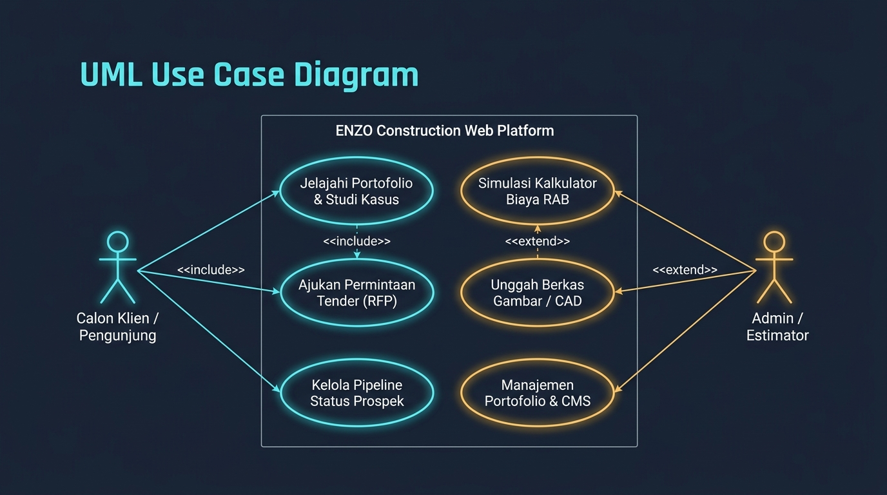

#### 3.1.1 Diagram Use Case Komprehensif (Mermaid)

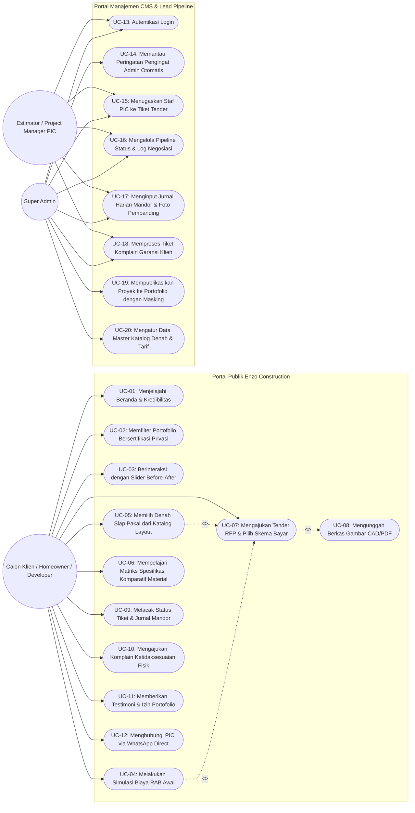

#### 3.1.2 Tabel Spesifikasi Use Case Inti (10 Fitur Evaluasi)
| ID | Nama Use Case | Aktor Terkait | Deskripsi Fungsional | Pre-Kondisi | Post-Kondisi |
|---|---|---|---|---|---|
| **UC-05** | Memilih Denah Katalog Layout | Calon Klien | Menjelajahi katalog denah terstandar (Type 45, 70, 120, Villa), meninjau blueprint 2D, render 3D fasad, dan meneruskannya ke form tender RFP. | Halaman `/layouts` diakses | Data layout terpilih otomatis mengisi formulir pengajuan RFP. |
| **UC-06** | Matriks Komparatif Spesifikasi | Calon Klien | Meninjau tabel perbandingan spesifikasi struktural, lantai, atap, genteng, utilitas, dan carport antara grade Standar, Premium, dan Luxury. | Halaman `/specifications` diakses | Konsumen memahami rincian material dan estimasi konsekuensi biaya. |
| **UC-07** | Pengajuan RFP & Opsi Pembayaran | Calon Klien | Mengisi formulir tender lengkap dengan preferensi skema bayar (*Cash*, *Cash Tempo 4 Termin*, atau *KPR Bank Rekanan*). | Form RFP diakses | Nomor tiket unik `RFP-xxxx` terbit dan notifikasi pengingat admin disiagakan. |
| **UC-09** | Pemantauan Jurnal Mandor | Calon Klien | Memantau tahapan konstruksi harian (Hari ke-1, 15, 35) dan komparasi visual berdampingan antara render 3D yang dijanjikan vs foto fisik lapangan. | Tiket RFP telah diterbitkan | Konsumen melihat transparansi opname fisik lapangan. |
| **UC-10** | Pengajuan Komplain Garansi | Calon Klien | Melaporkan ketidaksesuaian fisik (posisi sanitasi WC, warna cat/kusen, retak) disertai foto bukti untuk penanganan tim mutu. | Proyek dalam masa konstruksi/garansi | Tiket pengaduan `CMP-xxxx` terbentuk dan ditindaklanjuti mandor. |
| **UC-14** | Monitoring Pengingat Admin | Super Admin | Sistem otomatis memicu peringatan berkala jika tiket belum dibuka > 6 jam; pengingat berhenti begitu tiket dibuka admin. | Ada tiket status `submitted` > 6 jam | Banner peringatan aktif hingga admin membuka tiket. |
| **UC-15** | Penugasan Staf PIC | Super Admin | Menetapkan personil estimator atau project manager yang bertanggung jawab menangani tender/proyek tertentu. | Admin berada di halaman detail tiket | Relasi `assigned_to_user_id` tersimpan dan PIC terhubung. |
| **UC-16** | Pencatatan Riwayat Negosiasi | Estimator, Admin | Mencatat setiap tahapan perundingan harga, klarifikasi material, revisi BOQ, hingga kesepakatan final SPK *Deal*. | Tiket dalam proses evaluasi | Riwayat negosiasi tercatat berurutan pada `rfp_negotiation_logs`. |
| **UC-19** | Publikasi Portofolio & Masking | Super Admin | Menerbitkan proyek selesai ke etalase publik dengan enkripsi masking alamat dan nama pemilik hunian residensial (Poin 10). | Status tiket mencapai deal/selesai | Proyek tampil di portofolio publik tanpa membocorkan privasi hunian. |

---

### 3.2 Activity Diagram (Alur Pengajuan Tender, Penugasan PIC, & Komplain)

```mermaid
flowchart TD
    nodeStart([Mulai: Calon Klien Mengakses Web Enzo]) --> ViewHome[Melihat Beranda, Kredibilitas & Portfolio]
    ViewHome --> DecisionJalur{Pilihan Kebutuhan Konsumen?}

    DecisionJalur -->|Bingung Denah Sendiri| BukaLayouts[Buka Katalog Layout Denah: Type 45, 70, 120, Villa]
    DecisionJalur -->|Ingin Komparasi Material| BukaSpecs[Buka Matriks Spesifikasi Teknis Material]
    DecisionJalur -->|Hitung Anggaran Cepat| BukaKalkulator[Buka Kalkulator RAB Interaktif]
    DecisionJalur -->|Sudah Siap Ajukan Tender| BukaFormRFP[Buka Formulir Pengajuan RFP]

    BukaLayouts --> PilihDenah[Pilih Model Denah: Blueprint 2D + 3D Render]
    PilihDenah --> BukaFormRFP

    BukaSpecs --> PelajariSpek[Bandingkan Pondasi, Atap Baja/Kayu, Genteng Metal/Beton]
    PelajariSpek --> BukaFormRFP

    BukaKalkulator --> HitungRAB[Input Luas & Grade Material]
    HitungRAB --> BukaFormRFP

    BukaFormRFP --> InputRFP[Isi Data Proyek, Lokasi, Pilih Skema Bayar: Cash/Tempo/KPR]
    InputRFP --> UploadDocs{Punya Berkas Arsitektur Sendiri?}
    UploadDocs -->|Ya| UnggahFile[Unggah CAD / DWG / PDF TOR]
    UploadDocs -->|Tidak / Pakai Denah Acuan| SubmitTender[Kirim Permintaan Tender RFP]
    UnggahFile --> SubmitTender

    SubmitTender --> SimpanRFP[Sistem Terbitkan Tiket RFP-2610-XXX & Aktifkan Timer Pengingat 6 Jam]
    SimpanRFP --> TimerLoop{Admin Membuka Tiket Sebelum 6 Jam?}
    
    TimerLoop -->|Tidak| AlertReminder[Picu Peringatan Otomatis: Banner Merah di Admin & Notifikasi Berkala]
    AlertReminder --> AdminLogin[Admin Membuka Detail Tiket RFP]
    TimerLoop -->|Ya| AdminLogin

    AdminLogin --> StopReminder[Sistem Catat admin_last_viewed_at: Notifikasi Pengingat Otomatis Berhenti]
    StopReminder --> AssignPIC[Admin Tugaskan Staf PIC: Estimator / Project Manager]
    AssignPIC --> HubungiKlien[PIC Hubungi Klien via WA / Telepon untuk Survey & Negosiasi]
    HubungiKlien --> LogNegosiasi[Catat Tahap Negosiasi Harga & Spesifikasi ke Database]
    
    LogNegosiasi --> DealStatus{Mencapai Kesepakatan Final SPK?}
    DealStatus -->|Batal| RejectTender[Status Tiket: Ditolak/Batal]
    DealStatus -->|Deal| MulaiKonstruksi[Status: Deal Kontrak SPK Pelaksanaan]

    MulaiKonstruksi --> JurnalMandor[Mandor Input Jurnal Harian: Render 3D vs Kondisi Fisik Lapangan]
    JurnalMandor --> ClientPantau[Klien Pantau Progres di Portal Pelacakan /rfp/track]

    ClientPantau --> EvaluasiFisik{Apakah Fisik Lapangan Sesuai Pesanan?}
    EvaluasiFisik -->|Tidak Sesuai / Cacat| AjukanKomplain[Klien Ajukan Komplain: Posisi Sanitasi/Cat/Atap]
    AjukanKomplain --> InvestigasiMandor[Mandor & Tim Mutu Investigasi & Lakukan Perbaikan Fisik]
    InvestigasiMandor --> ClientPantau

    EvaluasiFisik -->|Selesai & Sempurna| SerahTerima[Serah Terima Kunci Proyek Selesai]
    SerahTerima --> TestimoniKlien[Klien Beri Ulasan Bintang 1-5 & Persetujuan Portofolio]
    TestimoniKlien --> PublishPorto[Admin Publikasikan ke Portofolio Publik: Masking Otomatis Privasi Alamat Hunian]
    PublishPorto --> Selesai([Selesai: Siklus Proyek Tuntas])
```

---

### 3.3 Sequence Diagram (Interaksi Sistem & Alur Pesan)

#### 3.3.1 Sequence Diagram: Pengingat Otomatis Admin (Admin Reminder Logic)

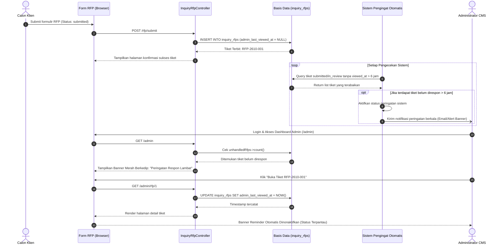

#### 3.3.2 Sequence Diagram: Jurnal Mandor, Pengaduan Komplain, & Masking Privasi

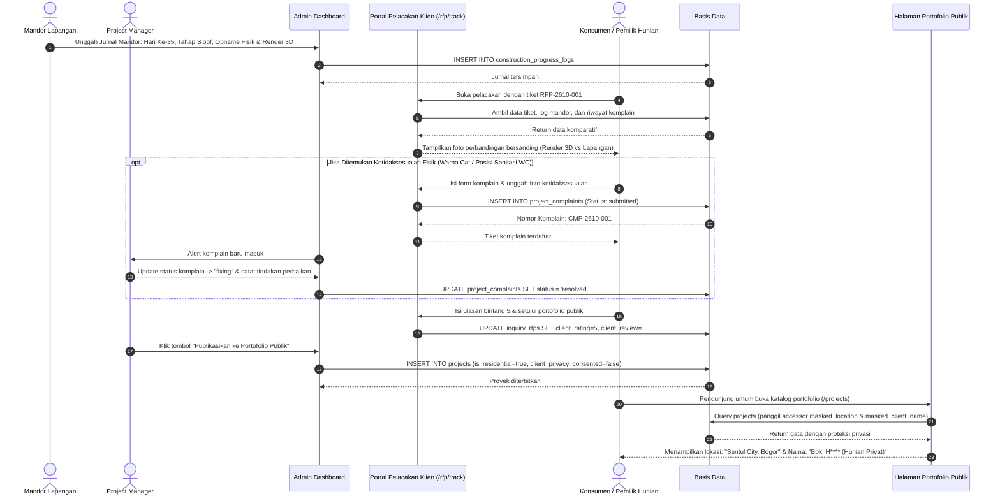

---

### 3.4 Class Diagram (Arsitektur Backend Laravel MVC & 10 Fitur Evaluasi)

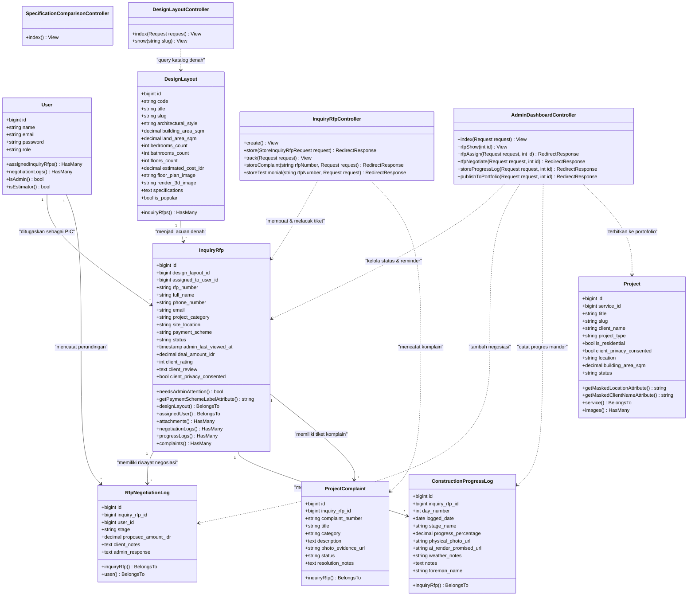

---

# BAGIAN 4: KESIMPULAN & KESIAPAN IMPLEMENTASI

1. **Konsistensi Arsitektur**:
   - Seluruh nama entitas (`inquiry_rfps`, `rfp_attachments`, `projects`, `services`, dll.) dan nama kolom foreign key (`inquiry_rfp_id`, `project_id`, `service_id`, `user_id`) telah **100% sinkron** dengan skema migrasi database Laravel yang ada di direktori `database/migrations/`.
2. **Kesesuaian dengan Profil Bisnis Kontraktor Modern**:
   - Wireframe mengintegrasikan elemen kredibilitas tinggi (standar ISO, sertifikasi K3, slider foto Before-After) serta magnet konversi (kalkulator biaya interaktif & pengunggahan berkas tender CAD/PDF).
3. **Kesiapan Menghadapi Sesi Asistensi**:
   - Dokumen ini telah menyajikan ulasan lengkap dan mendalam mencakup:
     - **ERD & Kamus Data**: Lengkap dengan tipe data presisi, batasan kunci (*constraints*), dan aturan normalisasi.
     - **Wireframe Antarmuka UI/UX**: Memberikan cetak biru tata letak visual (*layout hierarchy*) dari portal publik hingga panel admin CMS.
     - **Diagram UML**: Memenuhi standar rekayasa perangkat lunak dengan menghadirkan Use Case Diagram, Activity Diagram ber-swimlane, Sequence Diagram teknis, dan Class Diagram terstruktur.
