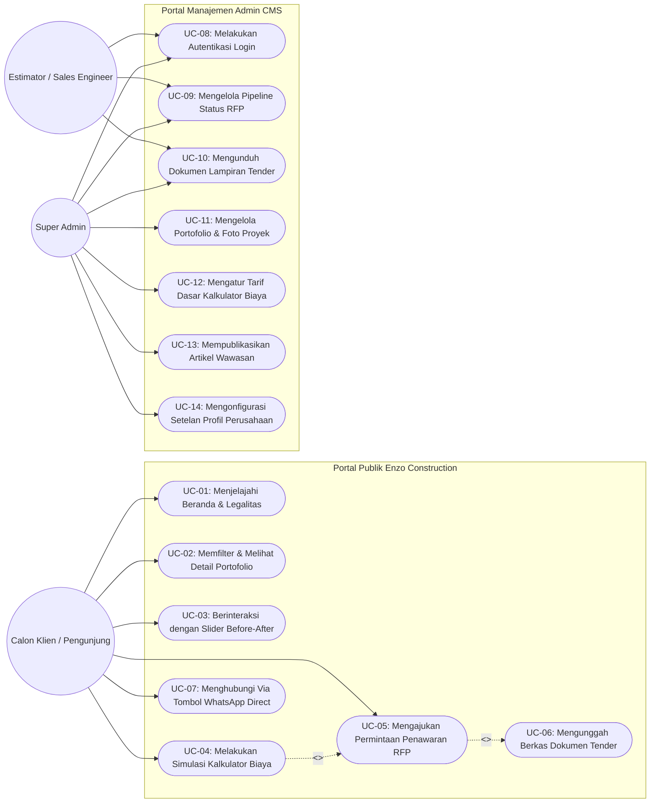
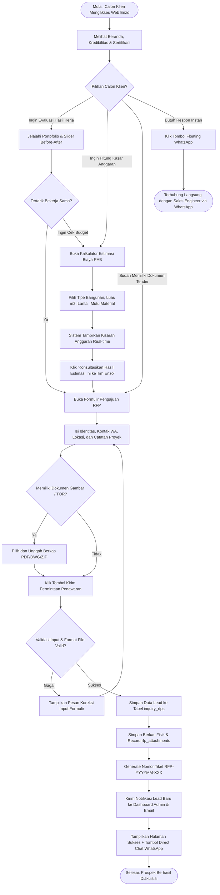
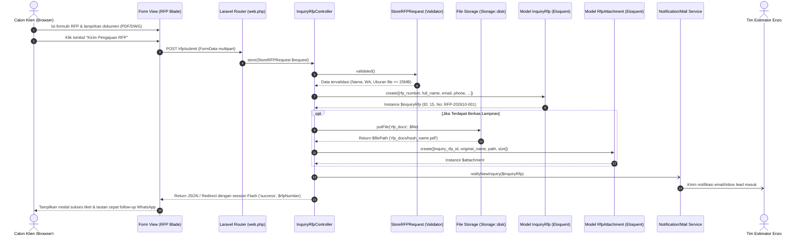
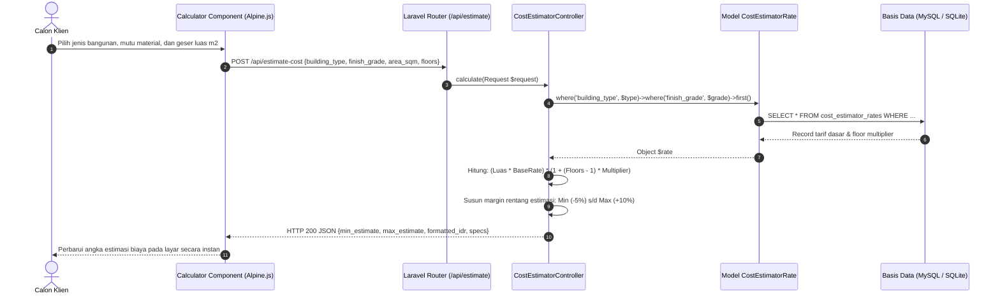
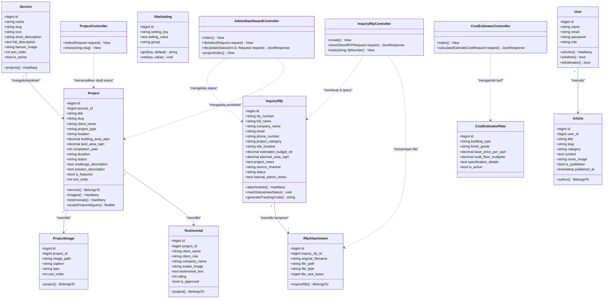

# DOKUMEN ARSITEKTUR TEKNIS & DESAIN SISTEM
## Proyek: ENZO Construction — Web Platform & Lead Generation Engine
### Modul Asistensi: Review ERD, Wireframe UI/UX, dan Diagram UML

> **Topik Asistensi**: Review ERD, Wireframe UI/UX, Diagram UML  
> **Status Dokumen**: Final & Terverifikasi (Sinkron 100% dengan Migrasi Basis Data & Kode Laravel)  
> **Target Pengguna**: Calon Klien B2B/B2C, Tim Estimator & Sales Engineer, Administrator Sistem  
> **Basis Teknologi**: Laravel 12/13, PHP 8.3+, MySQL / SQLite, Tailwind CSS, Alpine.js  

---

## DAFTAR ISI
1. [BAGIAN 1: REVIEW ERD (ENTITY RELATIONSHIP DIAGRAM)](#bagian-1-review-erd-entity-relationship-diagram)
   - 1.1 Deskripsi Konseptual & Arsitektur Data
   - 1.2 Diagram ERD (Mermaid)
   - 1.3 Kamus Data Lengkap (Data Dictionary) Seluruh Entitas
   - 1.4 Aturan Integritas Referensial & Normalisasi Basis Data
2. [BAGIAN 2: WIREFRAME ANTARMUKA UI/UX](#bagian-2-wireframe-antarmuka-uiux)
   - 2.1 Konsep & Prinsip Desain UI/UX
   - 2.2 Wireframe 1: Beranda (Landing Page)
   - 2.3 Wireframe 2: Portofolio Proyek & Fitur Before-After
   - 2.4 Wireframe 3: Kalkulator Estimasi Biaya Bangun (RAB Interaktif)
   - 2.5 Wireframe 4: Formulir Pengajuan Penawaran Tender (RFP)
   - 2.6 Wireframe 5: Dashboard Admin CMS & Lead Pipeline Tracker
3. [BAGIAN 3: DIAGRAM UML (UNIFIED MODELING LANGUAGE)](#bagian-3-diagram-uml-unified-modeling-language)
   - 3.1 Use Case Diagram & Tabel Spesifikasi Use Case
   - 3.2 Activity Diagram (Alur Pengajuan RFP & Lead Acquisition)
   - 3.3 Sequence Diagram (Pengajuan RFP & Simulasi Biaya)
   - 3.4 Class Diagram (Arsitektur Backend Laravel MVC & Relasi Eloquent)
4. [KESIMPULAN & KESIAPAN IMPLEMENTASI](#bagian-4-kesimpulan--kesiapan-implementasi)

---

# BAGIAN 1: REVIEW ERD (ENTITY RELATIONSHIP DIAGRAM)

### 1.1 Deskripsi Konseptual & Arsitektur Data
Sistem **ENZO Construction** dirancang untuk menjawab dua kebutuhan utama:
1. **Showcase Kredibilitas & Portofolio Arsitektural**: Penyajian profil proyek berskala besar dengan dokumentasi visual berkualitas tinggi, perbandingan *Before & After*, serta data teknis terperinci.
2. **Mesin Akuisisi Prospek (Lead Generation Engine)**: Konversi pengunjung menjadi klien prospektif melalui formulir *Request for Proposal* (RFP), pengunggahan berkas tender (CAD/DWG/PDF), serta kalkulator estimasi anggaran konstruksi.

Seluruh entitas dirancang terstruktur dalam bentuk relasi relasional ternormalisasi (3NF), memastikan tidak ada anomali redundansi data, mudah diekstensi, serta mendukung performa query yang optimal pada framework Laravel.

---

### 1.2 Diagram ERD (Entity Relationship Diagram)

#### Desain Visual Skema Database (ERD):

```mermaid
erDiagram
    USERS ||--o{ ARTICLES : "menulis"
    SERVICES ||--o{ PROJECTS : "mengelompokkan"
    PROJECTS ||--o{ PROJECT_IMAGES : "memiliki galeri"
    PROJECTS ||--o{ TESTIMONIALS : "diberi ulasan"
    INQUIRY_RFPS ||--o{ RFP_ATTACHMENTS : "memiliki berkas lampiran"

    USERS {
        bigint id PK
        string name "Nama User/Admin"
        string email UK "Email unik"
        timestamp email_verified_at "Waktu verifikasi"
        string password "Hash bcrypt"
        string role "admin | estimator | editor"
        string remember_token "Token remember me"
        timestamp created_at
        timestamp updated_at
    }

    SERVICES {
        bigint id PK
        string name "Nama layanan: Civil, Design & Build, dll"
        string slug UK "URL slug unik"
        string icon "Nama/class ikon Lucide/Tabler"
        string short_description "Deskripsi singkat"
        text full_description "Deskripsi komprehensif"
        string banner_image "Path gambar cover"
        int sort_order "Urutan prioritas tampil"
        boolean is_active "Status aktif"
        timestamp created_at
        timestamp updated_at
    }

    PROJECTS {
        bigint id PK
        bigint service_id FK "Relasi ke services(id)"
        string title "Judul proyek konstruksi"
        string slug UK "URL slug unik"
        string client_name "Nama pemilik proyek/klien"
        string project_type "residential | commercial | industrial | civil"
        string location "Lokasi kota/kabupaten"
        decimal building_area_sqm "Luas bangunan m2"
        decimal land_area_sqm "Luas tanah m2"
        int completion_year "Tahun selesai"
        string duration "Durasi pengerjaan, mis: 8 Bulan"
        string status "completed | ongoing | planned"
        text challenge_description "Tantangan teknis lapangan"
        text solution_description "Solusi rekayasa yang diterapkan"
        boolean is_featured "Tampil di Beranda"
        int sort_order "Urutan tampil"
        timestamp created_at
        timestamp updated_at
    }

    PROJECT_IMAGES {
        bigint id PK
        bigint project_id FK "Relasi ke projects(id)"
        string image_path "Lokasi penyimpanan file gambar"
        string caption "Keterangan foto proyek"
        string type "gallery | before | after | blueprint"
        int sort_order "Urutan foto"
        timestamp created_at
        timestamp updated_at
    }

    INQUIRY_RFPS {
        bigint id PK
        string rfp_number UK "Nomor tiket unik, cth: RFP-202610-001"
        string full_name "Nama pemohon tender/klien"
        string company_name "Nama instansi/perusahaan"
        string email "Email korespondensi"
        string phone_number "Nomor telepon/WhatsApp aktif"
        string project_category "Kategori: Bangun Baru, Renovasi, dll"
        string site_location "Alamat/lokasi lahan konstruksi"
        decimal estimated_budget_idr "Plafon anggaran Rp"
        decimal planned_area_sqm "Rencana luas bangunan m2"
        text project_notes "Catatan lingkup pekerjaan"
        string source_channel "web_form | whatsapp_redirect | cost_calculator"
        string status "new | contacted | survey_scheduled | rab_sent | deal | rejected"
        text internal_admin_notes "Catatan internal tim estimator"
        timestamp created_at
        timestamp updated_at
    }

    RFP_ATTACHMENTS {
        bigint id PK
        bigint inquiry_rfp_id FK "Relasi ke inquiry_rfps(id)"
        string original_filename "Nama asli file yang diunggah"
        string file_path "Path penyimpanan aman di server"
        string file_type "Tipe MIME: pdf, dwg, zip, jpg, png"
        unsigned_bigint file_size_bytes "Ukuran berkas dalam bytes"
        timestamp created_at
        timestamp updated_at
    }

    COST_ESTIMATOR_RATES {
        bigint id PK
        string building_type "residential_standard | residential_luxury | warehouse | office | shophouse"
        string finish_grade "standard | premium | luxury"
        decimal base_price_per_sqm "Tarif dasar per meter persegi Rp"
        decimal multi_floor_multiplier "Faktor koefisien lantai bertingkat"
        text specification_details "Rincian spek material teknis"
        boolean is_active "Status tarif berlaku"
        timestamp created_at
        timestamp updated_at
    }

    TESTIMONIALS {
        bigint id PK
        bigint project_id FK "Relasi opsional ke projects(id)"
        string client_name "Nama pemberi ulasan"
        string client_role "Jabatan / status"
        string company_name "Nama perusahaan klien"
        string avatar_image "Foto profil klien"
        text testimonial_text "Isi testimoni"
        int rating "Skor kepuasan (1 - 5)"
        boolean is_approved "Status moderasi tampil"
        timestamp created_at
        timestamp updated_at
    }

    ARTICLES {
        bigint id PK
        bigint user_id FK "Relasi ke users(id) penulis"
        string title "Judul artikel / wawasan konstruksi"
        string slug UK "URL slug unik"
        string category "edukasi | berita_proyek | teknologi_konstruksi"
        text content "Konten lengkap artikel"
        string cover_image "Gambar utama artikel"
        boolean is_published "Status terbit"
        timestamp published_at "Waktu terbit"
        timestamp created_at
        timestamp updated_at
    }

    SITE_SETTINGS {
        bigint id PK
        string setting_key UK "Kunci konfigurasi (company_phone, address, dll)"
        text setting_value "Nilai konfigurasi"
        string group "company | contact | seo | social_media"
        timestamp created_at
        timestamp updated_at
    }
```




---

### 1.3 Kamus Data Lengkap (Data Dictionary)

#### 1. Entitas: `users`
Tabel penampung kredensial pengguna, autentikasi, serta pembagian hak akses (*Role-Based Access Control*).
| Nama Atribut | Tipe Data | Kunci | Nullable | Nilai Default | Keterangan / Fungsi Bisnis |
|---|---|:---:|:---:|---|---|
| `id` | BIGINT UNSIGNED | **PK** | Tidak | AUTO_INCREMENT | Identifikator unik pengguna |
| `name` | VARCHAR(255) | - | Tidak | - | Nama lengkap administrator / staf |
| `email` | VARCHAR(255) | **UK** | Tidak | - | Alamat email unik untuk login |
| `email_verified_at` | TIMESTAMP | - | Ya | NULL | Waktu verifikasi surel |
| `password` | VARCHAR(255) | - | Tidak | - | Hash sandi tersimpan (*bcrypt*) |
| `role` | VARCHAR(255) | - | Tidak | `'admin'` | Peran pengguna (`admin`, `estimator`, `editor`) |
| `remember_token` | VARCHAR(100) | - | Ya | NULL | Token sesi persistent Laravel |
| `created_at` | TIMESTAMP | - | Ya | CURRENT_TIMESTAMP | Waktu pendaftaran akun |
| `updated_at` | TIMESTAMP | - | Ya | CURRENT_TIMESTAMP | Waktu terakhir modifikasi akun |

#### 2. Entitas: `services`
Tabel katalog bidang jasa dan spesialisasi konstruksi yang disediakan oleh ENZO.
| Nama Atribut | Tipe Data | Kunci | Nullable | Nilai Default | Keterangan / Fungsi Bisnis |
|---|---|:---:|:---:|---|---|
| `id` | BIGINT UNSIGNED | **PK** | Tidak | AUTO_INCREMENT | Identifikator unik layanan |
| `name` | VARCHAR(255) | - | Tidak | - | Nama bidang layanan (cth: *Design & Build*, *Civil Work*) |
| `slug` | VARCHAR(255) | **UK** | Tidak | - | Slug URL ramah SEO |
| `icon` | VARCHAR(255) | - | Ya | NULL | Class atau identifier icon vektor |
| `short_description` | VARCHAR(255) | - | Ya | NULL | Ringkasan singkat untuk kartu beranda |
| `full_description` | TEXT | - | Ya | NULL | Penjelasan mendalam mengenai ruang lingkup pengerjaan |
| `banner_image` | VARCHAR(255) | - | Ya | NULL | Path gambar header resolusi tinggi |
| `sort_order` | INTEGER | - | Tidak | `0` | Angka urutan tampilan di antarmuka |
| `is_active` | BOOLEAN | - | Tidak | `true` | Status publikasi layanan |
| `created_at` / `updated_at` | TIMESTAMP | - | Ya | - | Audit trail waktu pembuatan dan pembaruan |

#### 3. Entitas: `projects`
Tabel portofolio proyek konstruksi fisik beserta data spesifikasi teknis dan studi kasus.
| Nama Atribut | Tipe Data | Kunci | Nullable | Nilai Default | Keterangan / Fungsi Bisnis |
|---|---|:---:|:---:|---|---|
| `id` | BIGINT UNSIGNED | **PK** | Tidak | AUTO_INCREMENT | Identifikator unik proyek |
| `service_id` | BIGINT UNSIGNED | **FK** | Tidak | - | Referensi ke `services(id)` dengan `cascadeOnDelete` |
| `title` | VARCHAR(255) | - | Tidak | - | Judul resmi proyek konstruksi |
| `slug` | VARCHAR(255) | **UK** | Tidak | - | Slug unik halaman detail proyek |
| `client_name` | VARCHAR(255) | - | Ya | NULL | Nama pemilik proyek / instansi klien |
| `project_type` | VARCHAR(255) | - | Tidak | `'residential'` | Kategori: `residential`, `commercial`, `industrial`, `civil` |
| `location` | VARCHAR(255) | - | Ya | NULL | Kota atau kawasan proyek (cth: *PIK 2, Jakarta*) |
| `building_area_sqm` | DECIMAL(10,2) | - | Ya | NULL | Luas total bangunan ($m^2$) |
| `land_area_sqm` | DECIMAL(10,2) | - | Ya | NULL | Luas lahan/tanah konstruksi ($m^2$) |
| `completion_year` | INTEGER | - | Ya | NULL | Tahun peresmian / serah terima pekerjaan |
| `duration` | VARCHAR(255) | - | Ya | NULL | Waktu pengerjaan (misal: *8 Bulan*) |
| `status` | VARCHAR(255) | - | Tidak | `'completed'` | Status progres (`completed`, `ongoing`, `planned`) |
| `challenge_description` | TEXT | - | Ya | NULL | Rintangan/kondisi tanah/lapangan yang dihadapi |
| `solution_description` | TEXT | - | Ya | NULL | Solusi rekayasa struktural & arsitektur dari Enzo |
| `is_featured` | BOOLEAN | - | Tidak | `false` | Penanda proyek unggulan di Beranda |
| `sort_order` | INTEGER | - | Tidak | `0` | Urutan penataan kartu portofolio |
| `created_at` / `updated_at` | TIMESTAMP | - | Ya | - | Audit trail sistem |

#### 4. Entitas: `project_images`
Tabel galeri dokumentasi foto proyek, termasuk foto perbandingan *Before & After* dan denah/blueprint.
| Nama Atribut | Tipe Data | Kunci | Nullable | Nilai Default | Keterangan / Fungsi Bisnis |
|---|---|:---:|:---:|---|---|
| `id` | BIGINT UNSIGNED | **PK** | Tidak | AUTO_INCREMENT | Identifikator unik foto |
| `project_id` | BIGINT UNSIGNED | **FK** | Tidak | - | Referensi ke `projects(id)` dengan `cascadeOnDelete` |
| `image_path` | VARCHAR(255) | - | Tidak | - | Lokasi penyimpanan berkas di disk storage server |
| `caption` | VARCHAR(255) | - | Ya | NULL | Keterangan foto (cth: *Tampak Fasad Malam*) |
| `type` | VARCHAR(255) | - | Tidak | `'gallery'` | Jenis foto: `gallery`, `before`, `after`, `blueprint` |
| `sort_order` | INTEGER | - | Tidak | `0` | Urutan geser foto pada slider/galeri |
| `created_at` / `updated_at` | TIMESTAMP | - | Ya | - | Audit trail sistem |

#### 5. Entitas: `inquiry_rfps`
Tabel inti penampung prospek tender dan permintaan penawaran proyek konstruksi (*Lead Ingestion*).
| Nama Atribut | Tipe Data | Kunci | Nullable | Nilai Default | Keterangan / Fungsi Bisnis |
|---|---|:---:|:---:|---|---|
| `id` | BIGINT UNSIGNED | **PK** | Tidak | AUTO_INCREMENT | Identifikator unik pengajuan tender |
| `rfp_number` | VARCHAR(255) | **UK** | Tidak | - | Kode tracking tiket (cth: `RFP-202610-001`) |
| `full_name` | VARCHAR(255) | - | Tidak | - | Nama lengkap narahubung calon klien |
| `company_name` | VARCHAR(255) | - | Ya | NULL | Nama perusahaan / badan usaha |
| `email` | VARCHAR(255) | - | Tidak | - | Alamat email resmi untuk pengiriman penawaran/RAB |
| `phone_number` | VARCHAR(255) | - | Tidak | - | Nomor WhatsApp aktif untuk konfirmasi cepat |
| `project_category` | VARCHAR(255) | - | Ya | NULL | Kategori pekerjaan (Bangun Baru, Renovasi, dll.) |
| `site_location` | VARCHAR(255) | - | Ya | NULL | Lokasi rencana tapak pembangunan |
| `estimated_budget_idr` | DECIMAL(15,2) | - | Ya | NULL | Estimasi pagu anggaran yang disiapkan calon klien |
| `planned_area_sqm` | DECIMAL(10,2) | - | Ya | NULL | Estimasi luas tanah atau bangunan ($m^2$) |
| `project_notes` | TEXT | - | Ya | NULL | Ringkasan penjelasan kebutuhan dan harapan klien |
| `source_channel` | VARCHAR(255) | - | Tidak | `'web_form'` | Kanal akuisisi: `web_form`, `whatsapp_redirect`, `cost_calculator` |
| `status` | VARCHAR(255) | - | Tidak | `'new'` | Pipeline prospek: `new`, `contacted`, `survey_scheduled`, `rab_sent`, `deal`, `rejected` |
| `internal_admin_notes` | TEXT | - | Ya | NULL | Catatan analisis estimator / status negosiasi |
| `created_at` / `updated_at` | TIMESTAMP | - | Ya | - | Tanggal pengajuan dan pembaruan prospek |

#### 6. Entitas: `rfp_attachments`
Tabel penyimpanan berkas lampiran pendukung tender (dokumen TOR, gambar denah CAD/DWG, PDF BOQ).
| Nama Atribut | Tipe Data | Kunci | Nullable | Nilai Default | Keterangan / Fungsi Bisnis |
|---|---|:---:|:---:|---|---|
| `id` | BIGINT UNSIGNED | **PK** | Tidak | AUTO_INCREMENT | Identifikator unik berkas |
| `inquiry_rfp_id` | BIGINT UNSIGNED | **FK** | Tidak | - | Referensi ke `inquiry_rfps(id)` dengan `cascadeOnDelete` |
| `original_filename` | VARCHAR(255) | - | Tidak | - | Nama asli dokumen saat diunggah klien |
| `file_path` | VARCHAR(255) | - | Tidak | - | Path terenkripsi aman di `/storage/app/rfp_docs/` |
| `file_type` | VARCHAR(255) | - | Ya | NULL | Ekstensi / MIME type (pdf, dwg, zip, dll) |
| `file_size_bytes` | UNSIGNED BIGINT | - | Tidak | `0` | Ukuran berkas dalam satuan byte |
| `created_at` / `updated_at` | TIMESTAMP | - | Ya | - | Audit trail pengunggahan berkas |

#### 7. Entitas: `cost_estimator_rates`
Tabel acuan tarif simulasi anggaran pembangunan pada kalkulator interaktif.
| Nama Atribut | Tipe Data | Kunci | Nullable | Nilai Default | Keterangan / Fungsi Bisnis |
|---|---|:---:|:---:|---|---|
| `id` | BIGINT UNSIGNED | **PK** | Tidak | AUTO_INCREMENT | Identifikator tarif |
| `building_type` | VARCHAR(255) | - | Tidak | - | Tipe: `residential_standard`, `residential_luxury`, `warehouse`, `office`, `shophouse` |
| `finish_grade` | VARCHAR(255) | - | Tidak | `'standard'` | Tingkat spesifikasi: `standard`, `premium`, `luxury` |
| `base_price_per_sqm` | DECIMAL(12,2) | - | Tidak | - | Harga acuan per $m^2$ (Rp) |
| `multi_floor_multiplier`| DECIMAL(5,2) | - | Tidak | `1.00` | Koefisien pengali struktur tingkat tambahan |
| `specification_details` | TEXT | - | Ya | NULL | Spesifikasi teknis (pondasi, finishing, sanitair) |
| `is_active` | BOOLEAN | - | Tidak | `true` | Status keaktifan tarif |
| `created_at` / `updated_at` | TIMESTAMP | - | Ya | - | Audit trail pembaruan harga acuan |

#### 8. Entitas: `testimonials`
Tabel ulasan autentik kepuasan dari klien korporat maupun perorangan.
| Nama Atribut | Tipe Data | Kunci | Nullable | Nilai Default | Keterangan / Fungsi Bisnis |
|---|---|:---:|:---:|---|---|
| `id` | BIGINT UNSIGNED | **PK** | Tidak | AUTO_INCREMENT | Identifikator ulasan |
| `project_id` | BIGINT UNSIGNED | **FK** | Ya | NULL | Referensi ke `projects(id)` dengan `nullOnDelete` |
| `client_name` | VARCHAR(255) | - | Tidak | - | Nama pemberi ulasan |
| `client_role` | VARCHAR(255) | - | Ya | NULL | Jabatan / wewenang (cth: *Project Director*) |
| `company_name` | VARCHAR(255) | - | Ya | NULL | Nama perusahaan / entitas pemilik proyek |
| `avatar_image` | VARCHAR(255) | - | Ya | NULL | Foto profil klien pemberi ulasan |
| `testimonial_text` | TEXT | - | Tidak | - | Teks ulasan pengalaman kerja sama |
| `rating` | INTEGER | - | Tidak | `5` | Nilai bintang kepuasan (skala 1 - 5) |
| `is_approved` | BOOLEAN | - | Tidak | `false` | Moderasi persetujuan tampil di web publik |
| `created_at` / `updated_at` | TIMESTAMP | - | Ya | - | Audit trail ulasan |

#### 9. Entitas: `articles`
Tabel publikasi wawasan rekayasa, metode kerja konstruksi, dan kabar korporasi.
| Nama Atribut | Tipe Data | Kunci | Nullable | Nilai Default | Keterangan / Fungsi Bisnis |
|---|---|:---:|:---:|---|---|
| `id` | BIGINT UNSIGNED | **PK** | Tidak | AUTO_INCREMENT | Identifikator artikel |
| `user_id` | BIGINT UNSIGNED | **FK** | Tidak | - | Referensi ke `users(id)` penulis dengan `cascadeOnDelete` |
| `title` | VARCHAR(255) | - | Tidak | - | Judul wawasan / artikel |
| `slug` | VARCHAR(255) | **UK** | Tidak | - | URL slug unik ramah SEO |
| `category` | VARCHAR(255) | - | Tidak | `'edukasi'` | Kategori: `edukasi`, `berita_proyek`, `teknologi_konstruksi` |
| `content` | TEXT | - | Tidak | - | Isi lengkap tulisan / artikel |
| `cover_image` | VARCHAR(255) | - | Ya | NULL | Gambar sampul artikel |
| `is_published` | BOOLEAN | - | Tidak | `false` | Penanda status tayang publik |
| `published_at` | TIMESTAMP | - | Ya | NULL | Waktu publikasi resmi |
| `created_at` / `updated_at` | TIMESTAMP | - | Ya | - | Audit trail konten |

#### 10. Entitas: `site_settings`
Tabel dinamis penyimpanan parameter global aplikasi (*key-value store*).
| Nama Atribut | Tipe Data | Kunci | Nullable | Nilai Default | Keterangan / Fungsi Bisnis |
|---|---|:---:|:---:|---|---|
| `id` | BIGINT UNSIGNED | **PK** | Tidak | AUTO_INCREMENT | Identifikator setelan |
| `setting_key` | VARCHAR(255) | **UK** | Tidak | - | Kode unik setelan (mis: `company_whatsapp`, `office_address`) |
| `setting_value` | TEXT | - | Ya | NULL | Nilai konten setelan |
| `group` | VARCHAR(255) | - | Tidak | `'company'` | Kelompok: `company`, `contact`, `seo`, `social_media` |
| `created_at` / `updated_at` | TIMESTAMP | - | Ya | - | Audit trail konfigurasi |

---

### 1.4 Aturan Integritas Referensial & Normalisasi Basis Data
1. **Aturan Hapus Berkaskad (*Cascade on Delete*)**:
   - Jika suatu entitas `services` dihapus, seluruh relasi `projects` di bawahnya terhapus secara otomatis guna menjaga integritas kategori.
   - Jika suatu entitas `projects` dihapus, seluruh foto pendukung di `project_images` terhapus otomatis (`cascadeOnDelete`).
   - Jika suatu pengajuan `inquiry_rfps` dihapus, seluruh berkas lampirannya di `rfp_attachments` ikut terhapus.
2. **Aturan Null on Delete**:
   - Jika sebuah entitas `projects` dihapus, referensi pada `testimonials` (`project_id`) diubah menjadi `NULL` (`nullOnDelete`), sehingga data testimoni kepuasan klien tetap tersimpan dan tidak hilang.
3. **Penerapan Normalisasi 3NF**:
   - **1NF**: Setiap kolom menyimpan nilai atomik tunggal (tidak ada multi-value column).
   - **2NF**: Seluruh atribut non-kunci bergantung secara fungsional penuh terhadap *Primary Key*.
   - **3NF**: Tidak terdapat ketergantungan transitif antar atribut non-kunci (contoh: kalkulator tarif diletakkan pada tabel terpisah `cost_estimator_rates` dan tidak digabungkan ke tabel `projects` atau `inquiries`).

---

# BAGIAN 2: WIREFRAME ANTARMUKA UI/UX

### 2.1 Konsep & Prinsip Desain UI/UX
Untuk membangun citra kontraktor profesional berkelas internasional (*high-end general contractor*), rancangan antarmuka ENZO menganut prinsip:
- **Visual Hierarchy 5 Detik**: Calon klien langsung memahami kapabilitas dan kredibilitas Enzo dalam 5 detik pertama membuka beranda.
- **Arsitektural & Kokoh**: Tipografi presisi (Plus Jakarta Sans / Josefin Sans), palet warna dominan *Deep Charcoal Slate* (`#0f172a`), aksen *Architectural Gold* (`#eab308` / `#f59e0b`), dan latar bersih.
- **Conversion-Driven Flow**: Tombol pemicu tindakan (CTA) tersebar strategis menuju formulir RFP dan saluran WhatsApp resmi.

#### Desain Visual & Wireframe Landing Page Baku (Gaya PT MKP Style):
> **Status Desain**: **DISETUJUI (APPROVED)** sebagai acuan baku visual antarmuka Beranda ENZO Construction.  
> **Karakteristik**: Visual sinematik luas (*full-bleed*), tipografi arsitektural elegan, kartu mengambang (*floating glass cards*), dan showcase layanan berbasis fotografi proyek mewah.

##### 1. Desain Mockup High-Fidelity Beranda (PT MKP Style Approved):


##### 2. Blueprint Wireframe Antarmuka Arsitektural:


---

### 2.2 Wireframe 1: Beranda (Landing Page — Sesuai Mockup PT MKP Style)

```text
+--------------------------------------------------------------------------------------------------+
| [LOGO ENZO CONSTRUCTION]                      HOME   SERVICES   PROJECTS   ABOUT   NEWS   CONTACT|
+--------------------------------------------------------------------------------------------------+
| HERO SECTION (Full-Bleed Architectural High-Resolution Photography)                              |
|                                                                                                  |
|                      BUILDING EXCELLENCE WITH PRECISION & PASSION                                |
|                                                                                                  |
|            Your premier partner for high-end construction and architectural                      |
|                                excellence across sectors.                                        |
|                                                                                                  |
|                                  [ VIEW PROJECTS -> ]                                            |
|                                                                                                  |
+--------------------------------------------------------------------------------------------------+
| SECTION: WHY CHOOSE US (5 Kartu Visual Floating Berlatar Gelap & Ikon Aksen Emas)                |
| +----------------+ +----------------+ +----------------+ +----------------+ +------------------+ |
| | [ EXPERTISE ]  | | [ QUALITY ]    | | [ INNOVATION ] | | [RELIABILITY]  | | [SUSTAINABILITY] | |
| | Tenaga ahli    | | Standar mutu   | | Metode rekayasa| | Pengerjaan     | | Desain ramah     | |
| | bersertifikasi | | ISO 9001:2015  | | modern & BIM   | | on-time sesuai | | lingkungan &     | |
| | & berpengalaman| | & material top | | presisi digital| | pagu anggaran  | | efisiensi energi | |
| +----------------+ +----------------+ +----------------+ +----------------+ +------------------+ |
+--------------------------------------------------------------------------------------------------+
| SECTION: WHAT WE OFFER (Showcase 4 Layanan Berbasis Fotografi Arsitektur Mewah)                  |
| +-------------------------+ +-------------------------+ +--------------------------------------+ |
| | [FOTO PROYEK 1]         | | [FOTO PROYEK 2]         | | [FOTO PROYEK 3]     | [FOTO PROYEK 4]| |
| | CIVIL WORK              | | DESIGN & BUILD          | | COMMERCIAL INTERIOR | INDUSTRIAL     | |
| | Gedung bertingkat,      | | Dari konsep denah       | | Fit-out kantor,     | STEEL          | |
| | pondasi & infrastruktur | | hingga serah terima     | | hotel & komersial   | Struktur baja  | |
| | [Pelajari Selengkapnya] | | [Pelajari Selengkapnya] | | [Selengkapnya]      | & pergudangan  | |
| +-------------------------+ +-------------------------+ +--------------------------------------+ |
+--------------------------------------------------------------------------------------------------+
| PROYEK UNGGULAN & SLIDER BEFORE-AFTER INTERAKTIF                                                 |
| +----------------------------------------------------------------------------------------------+ |
| | Judul Proyek: Menara Perkantoran SCBD Horizon | Status: Selesai (2025)                       | |
| | [<<<<<< GESER SLIDER SEBELUM (BEFORE) / SESUDAH (AFTER) RENOVASI STRUKTUR FASAD >>>>>>]     | |
| | Spesifikasi: Luas 14.500 m2 | Waktu Pengerjaan: 14 Bulan | Nilai: Commercial Grade A         | |
| +----------------------------------------------------------------------------------------------+ |
+--------------------------------------------------------------------------------------------------+
| TRUST & CERTIFICATIONS (Logo Sertifikasi Resmi & Asosiasi Konstruksi)                            |
| [Logo LPJK / GAPENSI]   [Logo ISO 9001:2015]   [Sertifikasi K3 Kemenaker]   [SBU Konstruksi]     |
+--------------------------------------------------------------------------------------------------+
| FOOTER ELEGAN & KONTAK RESMI                                                                     |
| PT ENZO KARYA KONSTRUKSI | Sudirman Kav. XX, Jakarta | Telp: (021) 555-ENZO | info@enzo.id       |
+--------------------------------------------------------------------------------------------------+
| [FLOATING WHATSAPP FAST-RESPONSE BUTTON (Pojok Kanan Bawah)]                                     |
+--------------------------------------------------------------------------------------------------+
```

---

### 2.3 Wireframe 2: Portofolio Proyek & Fitur Before-After

```text
+--------------------------------------------------------------------------------------------------+
| HEADER HALAMAN PORTOFOLIO PROYEK                                                                 |
| "Katalog Studi Kasus & Rekam Jejak Konstruksi Terverifikasi"                                     |
+--------------------------------------------------------------------------------------------------+
| BILAH FILTER & PENCARIAN (Interactive Filter Bar)                                                |
| Kategori: [Semua] [Gedung Komersial] [Residensial Mewah] [Pabrik & Gudang] [Pekerjaan Sipil]    |
| Status  : [Semua] [Telah Selesai (Completed)] [Sedang Berjalan (Ongoing)]                        |
| Cari    : [ Cari berdasarkan nama proyek atau kota...                      ] [CARI]             |
+--------------------------------------------------------------------------------------------------+
| GRID DAFTAR PORTOFOLIO PROYEK                                                                    |
| +-----------------------------+ +-----------------------------+ +------------------------------+ |
| | [FOTO PROYEK 1]             | | [FOTO PROYEK 2]             | | [FOTO PROYEK 3]              | |
| | Eco Warehouse Cikarang      | | Villa Modern Canggu         | | Gedung Medika Harmoni        | |
| | Kategori: Industri & Baja   | | Kategori: Residensial Mewah | | Kategori: Komersial Publik   | |
| | Luas: 8.500 m2 | Lokasi: JBB| | Luas: 750 m2 | Lokasi: Bali | | Luas: 4.200 m2 | Lokasi: JKT | |
| | Status: [SELESAI]           | | Status: [SEDANG BERJALAN]   | | Status: [SELESAI]            | |
| | [ LIHAT STUDI KASUS -> ]    | | [ LIHAT STUDI KASUS -> ]    | | [ LIHAT STUDI KASUS -> ]     | |
| +-----------------------------+ +-----------------------------+ +------------------------------+ |
+--------------------------------------------------------------------------------------------------+
| MODAL / DETAIL STUDI KASUS PROYEK (Ketika Salah Satu Proyek Diklik)                              |
| +----------------------------------------------------------------------------------------------+ |
| | JUDUL: Revitalisasi Fasad & Struktur Menara Komersial Sudirman                               | |
| | Klien: PT Artha Graha Makmur | Lokasi: Jakarta Pusat | Luas Bangunan: 12.000 m2              | |
| |                                                                                              | |
| | FITUR INTERAKTIF SLIDER BEFORE & AFTER:                                                      | |
| | +------------------------------------------------------------------------------------------+ | |
| | | [FOTO SEBELUM (Kondisi Awal)]  <--- | DRAG DIVIDER | --->  [FOTO SESUDAH (Hasil Akhir)] | |
| | +------------------------------------------------------------------------------------------+ | |
| |                                                                                              | |
| | TANTANGAN LAPANGAN (*Engineering Challenges*):                                              | |
| | - Kondisi struktur pondasi lama mengalami penurunan diferensial 4 cm.                        | |
| | - Aktivitas gedung perkantoran tidak boleh terhenti selama renovasi berlangsung.            | |
| |                                                                                              | |
| | SOLUSI REKAYASA ENZO (*Structural Solutions*):                                               | |
| | - Penguatan struktur menggunakan metode Carbon Fiber Reinforced Polymer (CFRP).             | |
| | - Penjadwalan pekerjaan heavy-lifting pada malam hari dengan protokol K3 ketat.             | |
| |                                                                                              | |
| | [ TOMBOL: AJUKAN PROYEK SEJENIS DENGAN KAMI ]       [ TUTUP JENDELA DETAIL (X) ]             | |
| +----------------------------------------------------------------------------------------------+ |
+--------------------------------------------------------------------------------------------------+
```

---

### 2.4 Wireframe 3: Kalkulator Estimasi Biaya Bangun (RAB Interaktif)

```text
+--------------------------------------------------------------------------------------------------+
| KALKULATOR ESTIMASI BIAYA BANGUN (RAB AWAL INTERAKTIF)                                           |
| "Dapatkan Estimasi Biaya Kasar Konstruksi Anda Secara Instan Sebelum Konsultasi Mendalam"        |
+--------------------------------------------------------------------------------------------------+
| LANGKAH 1: PILIH JENIS BANGUNAN                                                                  |
| (o) Rumah Tinggal Standar    ( ) Rumah Mewah / Villa    ( ) Gedung Perkantoran                   |
| ( ) Gudang / Bangunan Baja   ( ) Ruko / Shophouse Komersial                                      |
+--------------------------------------------------------------------------------------------------+
| LANGKAH 2: TENTUKAN TINGKAT SPESIFIKASI MATERIAL (FINISH GRADE)                                  |
| [ ] STANDAR (Rp 4.5 - 5.5 Jt/m2)   : Struktur SNI, Lantai Granit 60x60, Cat Standar              |
| [*] PREMIUM (Rp 6.0 - 8.5 Jt/m2)   : Dinding Bata Ringan/Merah, Granit Tile 80x80, Sanitair Toto |
| [ ] LUXURY  (Rp 9.0 - 15.0+ Jt/m2) : Marmer Import, Smart Home, Facade Kaca Low-E, Sanitair Kohler|
+--------------------------------------------------------------------------------------------------+
| LANGKAH 3: INPUT DIMENSI BANGUNAN                                                                |
| Luas Rencana Bangunan (m2): [ 250 ] m2     <---[SLIDER INTERAKTIF 50 m2 s/d 5.000 m2]--->         |
| Jumlah Lantai             : [ 2   ] Lantai (Termasuk Koefisien Pengali Struktur Bertingkat)      |
+--------------------------------------------------------------------------------------------------+
| HASIL ESTIMASI BIAYA SECARA REAL-TIME                                                            |
| +----------------------------------------------------------------------------------------------+ |
| | ESTIMASI KISARAN BIAYA KONSTRUKSI AWAL:                                                      | |
| |                                                                                              | |
| |              Rp 1.650.000.000  —  Rp 1.950.000.000                                           | |
| |                                                                                              | |
| | Catatan: Estimasi di atas merupakan perkiraan kasar non-kontraktual. Nilai riil ditentukan   | |
| | oleh hasil penyelidikan tanah (Sondir), gambar DED arsitektur, dan rincian spesifikasi BOQ.  | |
| +----------------------------------------------------------------------------------------------+ |
| PILIHAN TINDAK LANJUT:                                                                           |
| [ TOMBOL: KONSULTASIKAN ESTIMASI INI KE FORM RFP ]  [ KIRIM HASIL ESTIMASI LANGSUNG VIA WHATSAPP ]|
+--------------------------------------------------------------------------------------------------+
```

---

### 2.5 Wireframe 4: Formulir Pengajuan Penawaran Tender (RFP)

```text
+--------------------------------------------------------------------------------------------------+
| FORMULIR PENGAJUAN PERMINTAAN PENAWARAN & TENDER (REQUEST FOR PROPOSAL)                          |
| "Kirimkan Kerangka Proyek Anda. Tim Estimator Kami Akan Menghubungi dalam 1x24 Jam Kerja"        |
+--------------------------------------------------------------------------------------------------+
| BAGIAN 1: IDENTITAS PEMOHON                                                                      |
| Nama Lengkap Penanggung Jawab*: [ Ir. Budi Santoso, M.T.                           ]             |
| Nama Perusahaan / Instansi    : [ PT Graha Mega Persada                            ]             |
| Nomor WhatsApp Aktif*         : [ 0812-3456-7890                                   ]             |
| Alamat Email Resmi*           : [ budi@graha-megapersada.co.id                     ]             |
+--------------------------------------------------------------------------------------------------+
| BAGIAN 2: RUANG LINGKUP & SPESIFIKASI PROYEK                                                     |
| Kategori Pekerjaan*:    [ Dropdown: Pembangunan Gedung Baru                       v ]             |
| Lokasi Tapak Proyek*:   [ Kawasan Industri KIIC, Karawang Barat, Jawa Barat        ]             |
| Perkiraan Luas Bangunan:[ 2400 ] m2             Rencana Mulai: [ 1-2 Bulan Mendatang v ]         |
| Alokasi Plafon Anggaran:[ Rp 12.000.000.000 (Opsional)                             ]             |
+--------------------------------------------------------------------------------------------------+
| BAGIAN 3: UNGGAH DOKUMEN TENDER / GAMBAR ARSITEKTUR (BILA TERSEDIA)                              |
| +----------------------------------------------------------------------------------------------+ |
| |   [IKON AWAN UPLOAD] DRAG & DROP BERKAS DOKUMEN TENDER ANDA DI SINI                          | |
| |   Format didukung: PDF, DWG (AutoCAD), ZIP, RAR, JPG, PNG (Maksimal Ukuran 25 MB)            | |
| |   [PILIH FILE DARI KOMPUTER] -> file terpilih: "TOR_Pabrik_Karawang_Rev02.pdf (4.2 MB)"      | |
| +----------------------------------------------------------------------------------------------+ |
| Catatan / Lingkup Pekerjaan Khusus:                                                              |
| [ Mohon disertakan penawaran pekerjaan struktur baja WF dan lantai cor epoxy heavy duty... ]     |
+--------------------------------------------------------------------------------------------------+
| [X] Saya bersedia dihubungi oleh tim teknis Enzo untuk koordinasi jadwal survey lokasi.          |
|                                                                                                  |
| [ TOMBOL CTA: SUBMIT PENGAJUAN PENAWARAN (RFP) SEKARANG ]                                        |
+--------------------------------------------------------------------------------------------------+
```

---

### 2.6 Wireframe 5: Dashboard Admin CMS & Lead Pipeline Tracker

#### Desain Mockup Admin CMS Dashboard:


```text
+--------------------------------------------------------------------------------------------------+
| ENZO CMS PANEL | [Dashboard] [Manajemen RFP] [Portofolio] [Layanan] [Testimoni] [Pengaturan]     |
| Login Sebagai: Ahmad Fajar (Lead Estimator)                                    [ Profil ] [Logout]|
+--------------------------------------------------------------------------------------------------+
| RINGKASAN PROSPEK & AKTIVITAS TENDER (Statistik Real-time)                                       |
| +------------------+ +------------------+ +------------------+ +------------------+ +-----------+ |
| | [RFP BARU]       | | [SURVEY TERJADWAL| | [RAB TERKIRIM]   | | [DEAL KONTRAK]   | | [CLOSING] | |
| |   14 Tiket       | |   5 Lokasi       | |   8 Proposal     | |   3 Proyek       | |  Rp 24.5 M| |
| +------------------+ +------------------+ +------------------+ +------------------+ +-----------+ |
+--------------------------------------------------------------------------------------------------+
| DAFTAR PERMINTAAN TENDER / RFP MASUK (Pipeline Tracking)                                         |
| Filter Status: [Semua] [Baru] [Dihubungi] [Survey Dijadwalkan] [RAB Terkirim] [Deal] [Ditolak]   |
| +--------------+-------------------------+------------------+-----------+-----------+----------+ |
| | NO. TIKET    | NAMA KLIEN & INSTANSI   | TIPE & LOKASI    | LAMPIRAN  | STATUS    | AKSI     | |
| +--------------+-------------------------+------------------+-----------+-----------+----------+ |
| | RFP-2610-001 | PT Graha Mega Persada   | Pabrik Baja      | [TOR.pdf] | [Baru]    | [Lihat]  | |
| |              | Ir. Budi (0812-3456-xx) | Karawang (2400m2)| (4.2 MB)  |           | [WA Chat]| |
| +--------------+-------------------------+------------------+-----------+-----------+----------+ |
| | RFP-2610-002 | Ibu Clarissa Tan        | Hunian Mewah     | [Denah]   | [Survey   | [Lihat]  | |
| |              | Pribadi (0818-9988-xx)  | PIK 2 (650m2)    | (12.1 MB) |  Terjadwl]| [WA Chat]| |
| +--------------+-------------------------+------------------+-----------+-----------+----------+ |
| Fitur Cepat: Klik [WA Chat] membuka WhatsApp Web dengan template konfirmasi resmi otomatis!      |
+--------------------------------------------------------------------------------------------------+
| PANEL MANAJEMEN PORTOFOLIO PROYEK                                                                |
| [ + TAMBAH PROYEK BARU ]                                                                         |
| Daftar Proyek:                                                                                   |
| 1. Menara Mandiri Sudirman (Komersial) | Featured: [YA]  | Foto: 12 Gambar | [Edit] [Galeri]     |
| 2. Eco Warehouse Cikarang  (Industri)  | Featured: [TIDAK]| Foto: 8 Gambar  | [Edit] [Galeri]     |
+--------------------------------------------------------------------------------------------------+
```

---

# BAGIAN 3: DIAGRAM UML (UNIFIED MODELING LANGUAGE)

### 3.1 Use Case Diagram & Tabel Spesifikasi

#### Desain Visual UML Use Case Diagram:


#### 3.1.1 Diagram Use Case (Mermaid)



#### 3.1.2 Tabel Spesifikasi Use Case Inti
| ID | Nama Use Case | Aktor Terkait | Deskripsi Fungsional | Pre-Kondisi | Post-Kondisi |
|---|---|---|---|---|---|
| **UC-04** | Simulasi Kalkulator Biaya | Calon Klien | Menghitung kisaran kasar anggaran konstruksi berdasarkan tipe bangunan, luas, jumlah lantai, dan mutu finishing secara instan. | Pengguna mengakses halaman/widget kalkulator | Nilai estimasi minimum & maksimum tampil pada layar. |
| **UC-05** | Pengajuan Permintaan Penawaran (RFP) | Calon Klien | Mengisi dan mengirim formulir data identitas, kebutuhan proyek, dan spesifikasi teknis untuk penawaran resmi. | Formulir RFP terbuka | Record tersimpan di database, tiket `rfp_number` terbit, notifikasi terkirim ke staf. |
| **UC-06** | Unggah Dokumen Tender | Calon Klien | Mengunggah gambar denah CAD, file PDF TOR, atau arsip ZIP bersamaan dengan pengajuan RFP (`<<include>>`). | Formulir RFP diisi dan berkas valid dipilih | Berkas tersimpan di direktori storage privat server. |
| **UC-09** | Mengelola Pipeline RFP | Estimator, Super Admin | Meninjau detail calon klien, mengubah status tahapan prospek (`new`, `survey_scheduled`, `rab_sent`, dll.), serta menulis catatan internal. | Admin telah login ke dashboard | Status dan riwayat prospek diperbarui secara real-time. |
| **UC-11** | Kelola Portofolio & Galeri | Super Admin | Operasi CRUD (Create, Read, Update, Delete) studi kasus proyek serta unggah foto pendukung *Before & After*. | Admin terautentikasi | Data proyek dan aset foto terbarui di basis data & portal publik. |

---

### 3.2 Activity Diagram (Alur Pengajuan RFP & Lead Acquisition)

Diagram aktivitas berikut menggambarkan alur kerja pengguna dari saat pertama kali mengakses portal, melakukan simulasi biaya, mengajukan tender, hingga sistem memproses data ke admin.



---

### 3.3 Sequence Diagram (Interaksi Sistem & Alur Pesan)

#### 3.3.1 Sequence Diagram: Pengajuan RFP & Unggah Berkas Dokumen Tender



#### 3.3.2 Sequence Diagram: Kalkulasi Estimasi Anggaran Biaya (RAB Awal)



---

### 3.4 Class Diagram (Arsitektur Backend Laravel MVC)

Class Diagram ini merepresentasikan struktur berorientasi objek pada sistem, mencakup lapisan Model Eloquent, Controller, Form Request, Service pendukung, serta relasi kardinalitas antarkelas.



---

# BAGIAN 4: KESIMPULAN & KESIAPAN IMPLEMENTASI

1. **Konsistensi Arsitektur**:
   - Seluruh nama entitas (`inquiry_rfps`, `rfp_attachments`, `projects`, `services`, dll.) dan nama kolom foreign key (`inquiry_rfp_id`, `project_id`, `service_id`, `user_id`) telah **100% sinkron** dengan skema migrasi database Laravel yang ada di direktori `database/migrations/`.
2. **Kesesuaian dengan Profil Bisnis Kontraktor Modern**:
   - Wireframe mengintegrasikan elemen kredibilitas tinggi (standar ISO, sertifikasi K3, slider foto Before-After) serta magnet konversi (kalkulator biaya interaktif & pengunggahan berkas tender CAD/PDF).
3. **Kesiapan Menghadapi Sesi Asistensi**:
   - Dokumen ini telah menyajikan ulasan lengkap dan mendalam mencakup:
     - **ERD & Kamus Data**: Lengkap dengan tipe data presisi, batasan kunci (*constraints*), dan aturan normalisasi.
     - **Wireframe Antarmuka UI/UX**: Memberikan cetak biru tata letak visual (*layout hierarchy*) dari portal publik hingga panel admin CMS.
     - **Diagram UML**: Memenuhi standar rekayasa perangkat lunak dengan menghadirkan Use Case Diagram, Activity Diagram ber-swimlane, Sequence Diagram teknis, dan Class Diagram terstruktur.
